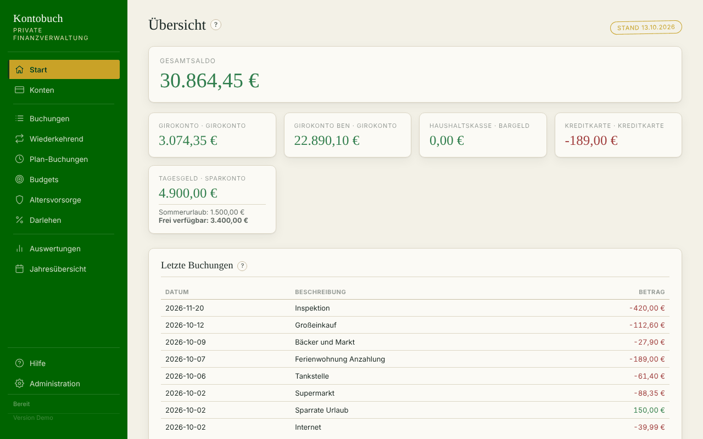
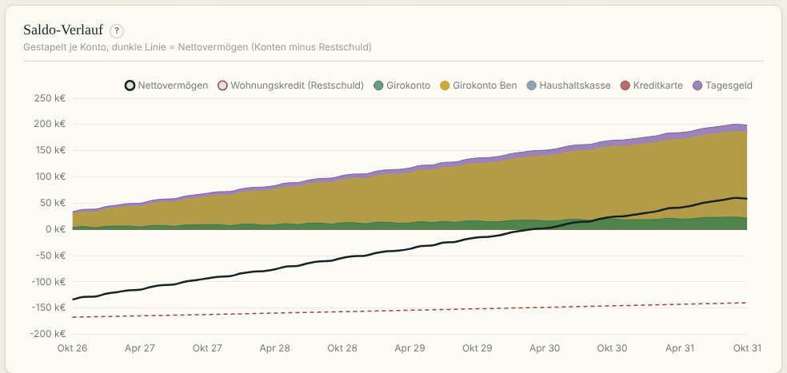
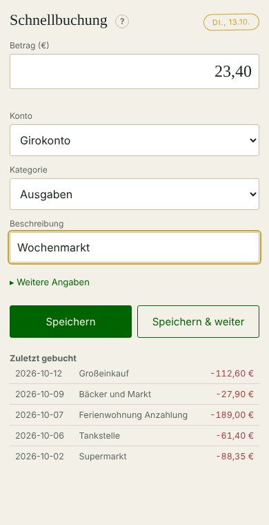

# Private Finanzverwaltung für Home Assistant

Ein Haushaltsbuch als Home-Assistant-Add-on: Konten, Buchungen, wiederkehrende
Zahlungen und Umbuchungen, Darlehen mit Tilgungsplan, Altersvorsorge, Budgets
und Sparziele mit Prognose, Auswertungen und Jahresübersicht. Dazu eine
Schnellbuchung für unterwegs, Buchen per Siri, XLSX-Export und -Import, eine
eingebaute Hilfe mit PDF-Handbuch sowie Backups mit Wiederherstellen.

Alles läuft lokal in Home Assistant. Die Daten liegen in einer SQLite-Datenbank
im Add-on und verlassen das Gerät nicht. Oberfläche und Hilfe sind deutsch.
Feiertage werden für das beim ersten Start gewählte Bundesland markiert,
fällige Termine verschieben sich nach dem Bankenkalender (TARGET).

## Bilder

Alle Bilder zeigen erfundene Demo-Daten. Es sind die Bilder der eingebauten
Hilfe, sie entstehen mit `werkzeuge/hilfe_bilder.py`.

**Übersicht:** Gesamtsaldo, Konten mit Sparzielen und letzte Buchungen.

**Auswertungen, Saldo-Verlauf:** Kontostände gestapelt und Nettovermögen
abzüglich Restschuld, mit Prognose aus Vorlagen, Darlehen und Altersvorsorge.

**Schnellbuchung auf dem Handy:** alle Felder auf einen Blick, die Kategorie
wird aus der Beschreibung vorgeschlagen.

## Installation

1. In Home Assistant: Einstellungen → Apps (früher Add-ons) → App-Store →
   Menü oben rechts → „Repositorys“.
2. Diese Adresse hinzufügen: `https://github.com/koch-r-de/ha-finanzverwaltung`
3. „Private Finanzverwaltung“ installieren und starten. Es erscheint
   „Finanzen“ in der Seitenleiste.

Unterstützt: amd64 und aarch64 (z. B. Raspberry Pi 4/5 mit 64-Bit-HAOS).

Optional bekommt die Schnellbuchung einen eigenen Eintrag in der Seitenleiste.
Dafür dieses Repository zusätzlich in HACS als Integration hinzufügen, siehe
[`ha-integration/README-HA-Integration.md`](ha-integration/README-HA-Integration.md).

**Wichtig:** Eine Deinstallation löscht alle Daten. Vorher in der
Administration „Datenbank herunterladen“.

## Aufbau des Repositorys

| Ordner / Datei | Inhalt |
| --- | --- |
| `finanzverwaltung/` | das Add-on (FastAPI, SQLite, HTML/CSS/JavaScript, Chart.js) |
| `finanzverwaltung/DOCS.md` | Dokumentation mit allen Versionen |
| `finanzverwaltung/CHANGELOG.md` | Änderungen je Version |
| `custom_components/finanzverwaltung/` | Integration für HACS: Schnellbuchung als eigener Seitenleisten-Eintrag |
| `hacs.json` | Angaben für HACS |
| `ha-integration/` | Anleitung zur Integration und zu Siri |
| `tests/` | fachliche Tests und Oberflächentests (Playwright) samt Testdatenbanken |
| `werkzeuge/` | Werkzeug für die Bildschirmfotos der Hilfe |
| `CLAUDE.md` | Hinweise für die Arbeit mit Claude Code |

## Mitwirken

Privates Projekt ohne Support und ohne Gewähr. Fehlermeldungen und Vorschläge
gern als Issue, eine Antwort oder Umsetzung ist nicht zugesagt.

Zum Entwickeln und Testen siehe `tests/README.md`.

## Lizenz

Copyright (C) 2026 koch-r-de. Lizenz GPL-3.0, siehe `LICENSE`. Mitgeliefert ist Chart.js (MIT-Lizenz, Hinweis in
`finanzverwaltung/app/static/vendor/chart.umd.min.js`).
