# Hilfe zur Finanzverwaltung
Programmversion: 2.6

## Erste Schritte
<!-- kapitel: erste-schritte -->

Die Finanzverwaltung ist dein Haushaltsbuch in Home Assistant. Du siehst hier, wie du dich zurechtfindest und womit du am besten anfängst.

### Was die Finanzverwaltung kann
<!-- kapitel: erste-schritte.ueberblick -->
<!-- stichworte: Überblick, Haushaltsbuch -->

Du führst deine Konten, erfasst Buchungen und lässt regelmäßige Zahlungen automatisch buchen. Budgets zeigen dir, wie viel von einem Betrag schon verbraucht ist. Darlehen und Verträge zur Altersvorsorge verwaltest du mit Tilgungsplan und Rentenzahlungen. Auswertungen zeigen dir, wie sich deine Konten entwickeln, auch in die Zukunft.

Alle Daten bleiben bei dir zu Hause in Home Assistant. Das Programm braucht keine Internetverbindung.

### So findest du dich zurecht
<!-- kapitel: erste-schritte.bedienung -->
<!-- stichworte: Seitenleiste, Fragezeichen, Hilfe öffnen, Zurück -->

Links steht die Seitenleiste mit allen Bereichen. „Start“ steht immer oben, „Hilfe“ und „Administration“ immer unten. Die Reihenfolge dazwischen legst du selbst fest.

Fast jede Ansicht hat oben rechts ein „?“. Auch viele Blöcke haben eines neben ihrer Überschrift. Ein Klick darauf öffnet die Hilfe genau an der passenden Stelle. Mit „Zurück“ oben in der Hilfe kommst du wieder dorthin, wo du warst.

In der Hilfe findest du links das Inhaltsverzeichnis. Oben kannst du nach Begriffen suchen. Die Treffer zeigen dir einen kurzen Auszug. Mit „PDF-Handbuch“ lädst du die ganze Hilfe als PDF mit Inhaltsverzeichnis und Seitenzahlen herunter.

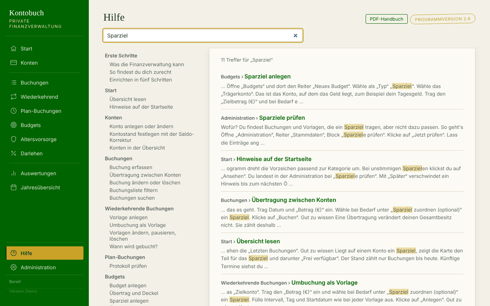

### Einrichten in fünf Schritten
<!-- kapitel: erste-schritte.einrichten -->
<!-- stichworte: Einrichtung, Anfangsbestand -->

1. Lege unter „Konten“ deine Konten an, zum Beispiel Girokonto und Tagesgeld. Siehe [Konto anlegen oder ändern](#konten.anlegen).
2. Trage für jedes Konto den aktuellen Kontostand als Saldo-Korrektur ein. Siehe [Kontostand festlegen](#konten.saldo-korrektur).
3. Lege unter „Wiederkehrend“ deine festen Zahlungen an: Gehalt, Miete, Versicherungen. Siehe [Vorlage anlegen](#wiederkehrend.anlegen).
4. Erfasse ab jetzt deine Ausgaben unter „Buchungen“ oder unterwegs mit der Schnellbuchung. Siehe [Buchung erfassen](#buchungen.erfassen).
5. Wenn du magst: Lege Budgets an, zum Beispiel für Lebensmittel. Siehe [Budget anlegen](#budgets.anlegen).

Gemeinsamer Haushalt? Lege zuerst unter Administration die Personen an. Dann kannst du Konten und Verträge einer Person zuordnen. Siehe [Personen](#admin.personen).

## Start
<!-- kapitel: start -->

Die Startseite zeigt dir auf einen Blick, wie es um deine Konten steht.

### Übersicht lesen
<!-- kapitel: start.uebersicht -->
<!-- stichworte: Gesamtsaldo, Kontokarte, Frei verfügbar -->

**Wofür?** Du siehst den Gesamtsaldo, den Stand jedes Kontos und die letzten Buchungen.

**So geht's**

1. Klicke in der Seitenleiste auf „Start“.
2. Oben steht der „Gesamtsaldo“. Er zählt alle Konten zusammen, bei denen „Im Gesamtsaldo“ angehakt ist.
3. Darunter steht je Konto eine Karte mit dem aktuellen Stand.
4. Ganz unten stehen die „Letzten Buchungen“.

**Gut zu wissen**

- Liegt auf einem Konto ein Sparziel, zeigt die Karte den Teil für das Sparziel und darunter „Frei verfügbar“.
- Der Stand zählt nur Buchungen bis heute. Künftige Termine siehst du in der Buchungsliste und in den Auswertungen.


**Siehe auch:** [Konten in der Übersicht](#konten.liste), [Sparziel anlegen](#budgets.sparziel)

### Hinweise auf der Startseite
<!-- kapitel: start.hinweise -->
<!-- stichworte: Banner, Vorzeichen-Konflikt, Sparziel-Zuordnung -->

**Wofür?** Das Programm prüft bei jedem Öffnen deine Daten. Findet es etwas Unstimmiges, erscheint oben ein Hinweis.

**So geht's**

1. Lies den Hinweis oben auf der Startseite.
2. Bei unpassenden Vorzeichen klickst du auf „Jetzt korrigieren“ und bestätigst die Rückfrage. Das Programm dreht die Vorzeichen passend zur Kategorie um.
3. Bei unstimmigen Sparzielen klickst du auf „Ansehen“. Du landest in der Administration bei „Sparziele prüfen“.
4. Mit „Später“ verschwindet ein Hinweis bis zum nächsten Öffnen.

**Gut zu wissen**

- Ein Vorzeichen-Hinweis bedeutet: Eine Ausgabe ist als Einnahme gebucht oder umgekehrt.
- Ein Sparziel-Hinweis bedeutet: Eine Buchung trägt ein Sparziel, obwohl sie nicht zum Sparziel passt.

**Siehe auch:** [Vorzeichen prüfen](#admin.vorzeichen), [Sparziele prüfen](#admin.sparziele)

## Konten
<!-- kapitel: konten -->

Hier legst du deine Konten an und bestimmst ihren Stand.

### Konto anlegen oder ändern
<!-- kapitel: konten.anlegen -->
<!-- stichworte: Konto, Kontotyp, Eröffnungsdatum, Gesamtsaldo, Kontofarbe -->

**Wofür?** Jedes Bankkonto, jede Kreditkarte und deine Barkasse bekommen ein eigenes Konto im Programm.

**So geht's**

1. Öffne „Konten“.
2. Trag im Block „Neues Konto“ den „Name“ ein und wähle den „Typ“: „Girokonto“, „Sparkonto“, „Kreditkarte“ oder „Bargeld“.
3. Wähle das „Eröffnungsdatum“.
4. Wähle bei Bedarf eine „Person (optional)“.
5. Lass „Im Gesamtsaldo“ angehakt, wenn das Konto in den Gesamtsaldo auf der Startseite zählen soll.
6. Hake „Eigene Farbe“ an, wenn das Konto in Diagrammen immer dieselbe Farbe haben soll, und wähle sie aus.
7. Klicke auf „Anlegen“.

Zum Ändern klickst du in der Tabelle „Alle Konten“ bei dem Konto auf „Ändern“. Das Formular füllt sich. Ändere, was du willst, und klicke auf „Änderung speichern“. Mit „Änderung verwerfen“ brichst du ab.

**Gut zu wissen**

- Ein Konto löschst du nicht hier, sondern unter Administration bei „Daten zurücksetzen“.
- Ohne eigene Farbe wählt das Programm für jedes Konto automatisch eine.

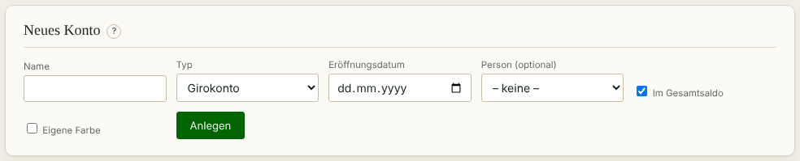

**Siehe auch:** [Kontostand festlegen](#konten.saldo-korrektur), [Konten löschen](#zuruecksetzen.konten-loeschen)

### Kontostand festlegen mit der Saldo-Korrektur
<!-- kapitel: konten.saldo-korrektur -->
<!-- stichworte: Saldo-Korrektur, Anfangsbestand, Kontostand -->

**Wofür?** Du sagst dem Programm, welcher Stand an einem Tag auf dem Konto war. So stimmt der Stand, auch wenn du nicht alle alten Buchungen erfasst hast.

**So geht's**

1. Öffne „Konten“ und gehe zum Block „Saldo-Korrektur“.
2. Wähle das „Konto“.
3. Wähle das „Datum“. Vorbelegt ist heute.
4. Trag bei „Saldo (€)“ den Kontostand ein, wie er auf dem Kontoauszug steht.
5. Schreib bei Bedarf einen „Kommentar“ dazu.
6. Klicke auf „Korrektur anlegen“.

**Gut zu wissen**

<!-- hinweis: konten.saldo-korrektur -->
Die Korrektur setzt den Kontostand ab diesem Datum fest. Buchungen mit einem früheren Datum ändern den Stand danach nicht mehr. Ein Datum in der Zukunft ist nicht möglich.
<!-- /hinweis -->

- Buchungen am selben Tag rechnet das Programm zum eingetragenen Stand hinzu. Trag also den Stand vor den Buchungen dieses Tages ein.
- Für den Start reicht eine Korrektur je Konto mit dem heutigen Stand.

**Siehe auch:** [Einrichten in fünf Schritten](#erste-schritte.einrichten)

### Konten in der Übersicht
<!-- kapitel: konten.liste -->
<!-- stichworte: Kontenliste, Personenfilter -->

**Wofür?** Die Tabelle „Alle Konten“ zeigt jedes Konto mit Typ, Person, Eröffnungsdatum und aktuellem Saldo.

**So geht's**

1. Öffne „Konten“.
2. Wähle oben rechts im Block „Alle Konten“ eine Person, wenn du nur ihre Konten sehen willst.
3. Klicke bei einem Konto auf „Ändern“, um es zu bearbeiten.

**Gut zu wissen**

- Die Spalte „Gesamtsaldo“ zeigt, ob das Konto im Gesamtsaldo der Startseite zählt.
- Der farbige Punkt vor dem Namen ist die Farbe des Kontos in Diagrammen.

**Siehe auch:** [Konto anlegen oder ändern](#konten.anlegen), [Personen](#admin.personen)

## Buchungen
<!-- kapitel: buchungen -->

Hier erfasst du Einnahmen, Ausgaben und Übertragungen und findest alle Buchungen wieder.

### Buchung erfassen
<!-- kapitel: buchungen.erfassen -->
<!-- stichworte: Buchung, Ist-Buchung, Plan-Buchung, Vorzeichen, Doppelbuchung -->

**Wofür?** Jede Einnahme und Ausgabe, die nicht automatisch gebucht wird, erfasst du hier.

**So geht's**

1. Öffne „Buchungen“.
2. Wähle im Block „Neue Buchung“ das „Konto“.
3. Wähle den „Typ“: „Ist“ für eine Zahlung, die schon passiert ist, oder „Plan“ für eine Zahlung in der Zukunft.
4. Wähle das „Datum“. Vorbelegt ist heute. Ist der Tag ein Feiertag, steht ein Hinweis unter dem Feld.
5. Trag den „Betrag (€)“ ohne Vorzeichen ein.
6. Wähle die „Kategorie“, zum Beispiel „Lebensmittel/Verpflegung“.
7. Schreib bei Bedarf eine „Beschreibung“ dazu.
8. Klicke auf „Buchen“.

**Gut zu wissen**

- Ob der Betrag eine Ausgabe oder Einnahme ist, ergibt sich aus der Kategorie. Du gibst den Betrag immer positiv ein.
- Eine Plan-Buchung wird an ihrem Datum beim nächsten Start automatisch zur Ist-Buchung.
- Gibt es am selben Tag auf demselben Konto schon den gleichen Betrag, erscheint ein Hinweis auf eine mögliche Doppelbuchung. Gebucht wird trotzdem.

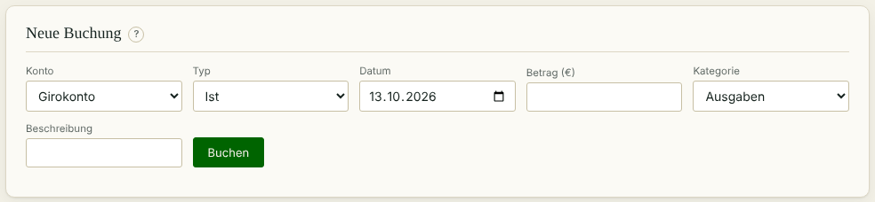

**Siehe auch:** [Übertragung zwischen Konten](#buchungen.uebertragung), [Schnellbuchung nutzen](#schnellbuchung.nutzen)

### Übertragung zwischen Konten
<!-- kapitel: buchungen.uebertragung -->
<!-- stichworte: Übertragung, Umbuchung, Zielkonto, Sparziel -->

**Wofür?** Du verschiebst Geld von einem deiner Konten auf ein anderes, zum Beispiel vom Girokonto aufs Tagesgeld.

**So geht's**

1. Öffne „Buchungen“.
2. Wähle als „Typ“ „Übertragung“. Statt der Kategorie erscheint das Feld „Zielkonto“.
3. Wähle das „Konto“, von dem das Geld kommt, und das „Zielkonto“, auf das es geht.
4. Trag Datum und „Betrag (€)“ ein.
5. Wähle bei Bedarf unter „Sparziel zuordnen (optional)“ ein Sparziel.
6. Klicke auf „Buchen“.

**Gut zu wissen**

- Eine Übertragung verändert deinen Gesamtbesitz nicht. Sie zählt deshalb nicht in Cashflow, Kategorien und Budgets.
- Ein Sparziel kannst du nur wählen, wenn das Konto oder das Zielkonto das Trägerkonto des Sparziels ist. Geld auf das Trägerkonto zählt als Einzahlung, Geld vom Trägerkonto als Entnahme.
- Für regelmäßige Übertragungen gibt es Umbuchungs-Vorlagen.

**Siehe auch:** [Umbuchung als Vorlage](#wiederkehrend.umbuchung), [Sparziel anlegen](#budgets.sparziel)

### Buchung ändern oder löschen
<!-- kapitel: buchungen.aendern -->
<!-- stichworte: Buchung ändern, Buchung löschen -->

**Wofür?** Du korrigierst einen Tippfehler oder entfernst eine falsche Buchung.

**So geht's**

1. Öffne „Buchungen“ und suche die Buchung in der Liste.
2. Klicke auf „Ändern“. Das Formular oben füllt sich mit der Buchung.
3. Ändere die Werte und klicke auf „Änderung speichern“. Mit „Änderung verwerfen“ brichst du ab.
4. Zum Löschen klickst du in der Liste auf „Löschen“ und bestätigst die Rückfrage.

**Gut zu wissen**

- Auch beim Ändern gibst du den Betrag positiv ein.
- Eine automatisch gebuchte Zahlung aus einer Vorlage, einem Darlehen oder einer Altersvorsorge entsteht nicht neu, wenn du sie löschst.

**Siehe auch:** [Protokoll prüfen](#plan.protokoll)

### Buchungsliste filtern
<!-- kapitel: buchungen.liste -->
<!-- stichworte: Buchungsliste, Herkunft, anstehende Termine, Filter -->

**Wofür?** Du siehst genau die Buchungen, die dich gerade interessieren, auch die Termine, die noch kommen.

**So geht's**

1. Öffne „Buchungen“ und gehe zum Block „Buchungsliste & Suche“.
2. Wähle bei Bedarf ein „Konto“ und eine „Person“.
3. Wähle bei „Anzeigen“, was du sehen willst:
   - „Nur Ist-Buchungen (manuell)“ zeigt deine selbst erfassten Zahlungen.
   - „Nur Plan-Buchungen (manuell)“ zeigt deine vorgemerkten Zahlungen.
   - „Nur automatisch (Wiederkehrend / Darlehen / Altersvorsorge)“ zeigt, was das Programm gebucht hat.
   - „Inkl. anstehender Termine“ zeigt zusätzlich die kommenden Termine aus Vorlagen, Darlehen und Altersvorsorge.
   - „Alles“ zeigt alle gespeicherten Buchungen.
4. Hake „Inflation einrechnen (nur anstehende Termine)“ an, wenn kommende Termine mit Inflation hochgerechnet werden sollen.

**Gut zu wissen**

- Anstehende Termine erscheinen blasser und mit „geplant“. Sie sind noch nicht gespeichert und lassen sich deshalb nicht ändern.
- Die Spalte „Herkunft“ zeigt, woher eine Buchung stammt: „manuell“, „Vorlage“, „Darlehen“, „Altersvorsorge“ oder „anstehend“.
- Bei einer Übertragung steht in der Spalte „Konto“ Quelle → Ziel.
- Ein kleines „F“ hinter dem Datum zeigt einen Feiertag. Zeig mit der Maus darauf, dann siehst du den Namen.

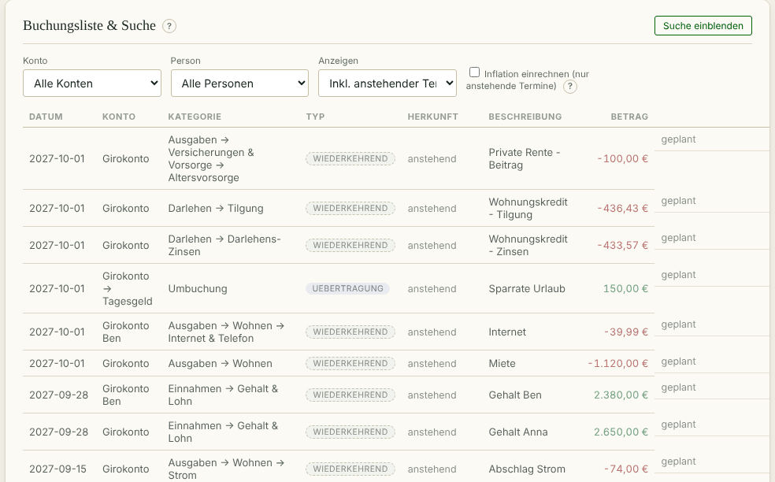

**Siehe auch:** [Buchungen suchen](#buchungen.suche), [Inflation einrechnen](#auswertungen.inflation)

### Buchungen suchen
<!-- kapitel: buchungen.suche -->
<!-- stichworte: Suche, Buchung finden -->

**Wofür?** Du findest eine bestimmte Buchung über Text, Betrag, Zeitraum oder Kategorie.

**So geht's**

1. Öffne „Buchungen“ und klicke auf „Suche einblenden“.
2. Fülle die Felder, die du brauchst: „Beschreibung / Kategorie“, „Betrag von“ und „Betrag bis“, „Datum von“ und „Datum bis“, „Konto“, „Kategorie“, „Person“, „Typ“.
3. Lass „inkl. Unterkategorien“ angehakt, wenn auch Unterkategorien gefunden werden sollen.
4. Klicke auf „Suchen“. Mit „Zurücksetzen“ leerst du die Felder.

**Gut zu wissen**

- Alle Felder sind freiwillig. Leere Felder schränken nicht ein.

**Siehe auch:** [Buchungsliste filtern](#buchungen.liste)

## Wiederkehrende Buchungen
<!-- kapitel: wiederkehrend -->

Hier legst du Vorlagen für Zahlungen an, die regelmäßig kommen. Das Programm bucht sie dann von selbst.

### Vorlage anlegen
<!-- kapitel: wiederkehrend.anlegen -->
<!-- stichworte: Vorlage, Dauerauftrag, Intervall, wiederkehrende Buchung -->

**Wofür?** Gehalt, Miete, Versicherungen und Abos musst du nicht jedes Mal selbst buchen.

**So geht's**

1. Öffne „Wiederkehrend“.
2. Lass im Block „Neue Vorlage“ bei „Art“ „Buchung“ stehen.
3. Wähle „Konto“ und bei Bedarf „Person (optional)“.
4. Trag den „Betrag (€)“ ohne Vorzeichen ein und wähle die „Kategorie“.
5. Schreib eine „Beschreibung“, zum Beispiel „Miete“.
6. Wähle das „Intervall“: „Monatlich“, „Quartalsweise“, „Halbjährlich“ oder „Jährlich“.
7. Trag den „Tag des Monats“ ein. Bei allem außer monatlich trägst du auch den „Monat“ der ersten Zahlung im Jahr ein.
8. Wähle das „Startdatum“ und bei Bedarf ein „Enddatum (optional)“.
9. Hake „Inflations-abhängig“ an, wenn der Betrag in Prognosen mit der Inflation steigen soll.
10. Klicke auf „Anlegen“.

**Gut zu wissen**

- Fällt ein Termin auf ein Wochenende oder einen Bankfeiertag, bucht das Programm am Werktag davor.
- Nach dem Speichern nennt das Programm unter dem Formular die Termine der nächsten 12 Monate, die auf einen Feiertag fallen. Das ist nur ein Hinweis.
- Liegt das Startdatum in der Vergangenheit, holt das Programm die verpassten Termine nach.
- Die Vorlagen-Tabelle scrollt für sich. Das Formular bleibt dabei oben stehen.

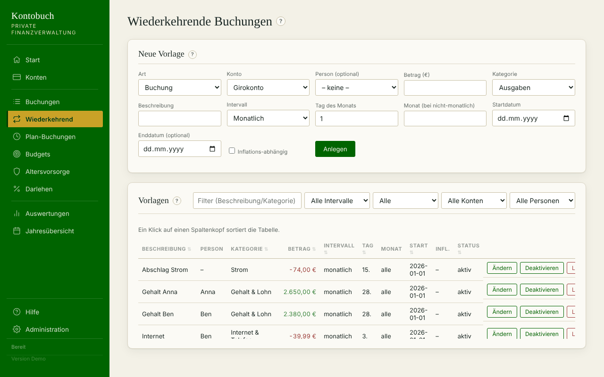

**Siehe auch:** [Wann wird gebucht?](#wiederkehrend.automatik), [Umbuchung als Vorlage](#wiederkehrend.umbuchung)

### Umbuchung als Vorlage
<!-- kapitel: wiederkehrend.umbuchung -->
<!-- stichworte: Umbuchung, Sparrate, Umbuchungs-Vorlage -->

**Wofür?** Eine regelmäßige Übertragung zwischen deinen Konten, zum Beispiel eine monatliche Sparrate aufs Tagesgeld.

**So geht's**

1. Öffne „Wiederkehrend“.
2. Wähle bei „Art“ „Umbuchung“. Statt der Kategorie erscheint „Zielkonto“.
3. Wähle das „Konto“, von dem das Geld kommt, und das „Zielkonto“.
4. Trag den „Betrag (€)“ ein und wähle bei Bedarf unter „Sparziel zuordnen (optional)“ ein Sparziel.
5. Fülle Intervall, Tag und Startdatum wie bei jeder Vorlage aus.
6. Klicke auf „Anlegen“.

**Gut zu wissen**

- Konto und Zielkonto müssen verschieden sein.
- Eine Umbuchung kennt keine Inflation.
- In der Tabelle steht bei einer Umbuchung in der Spalte „Kategorie“ „Umbuchung → Zielkonto“.

**Siehe auch:** [Übertragung zwischen Konten](#buchungen.uebertragung), [Sparziel anlegen](#budgets.sparziel)

### Vorlagen ändern, pausieren, löschen
<!-- kapitel: wiederkehrend.verwalten -->
<!-- stichworte: Vorlage ändern, Vorlage deaktivieren, Vorlage löschen, Sortieren -->

**Wofür?** Du passt eine Vorlage an, wenn sich ein Betrag ändert, oder hältst sie an.

**So geht's**

1. Öffne „Wiederkehrend“ und suche die Vorlage in der Tabelle „Vorlagen“. Die Filter oben helfen dabei.
2. Klicke auf „Ändern“. Das Formular oben füllt sich. Ändere die Werte und klicke auf „Änderung speichern“.
3. Klicke auf „Deaktivieren“, um die Vorlage anzuhalten. Mit „Aktivieren“ läuft sie wieder.
4. Klicke auf „Löschen“, um die Vorlage ganz zu entfernen.

**Gut zu wissen**

<!-- hinweis: tabelle.sortieren -->
Ein Klick auf einen Spaltenkopf sortiert die Tabelle.
<!-- /hinweis -->

- Eine Änderung wirkt auf künftige Termine. Schon gebuchte Zahlungen bleiben, wie sie sind.
- Aktivierst du eine Vorlage wieder, holt sie die Termine der Pause nach. Willst du das nicht, ändere vorher das Startdatum.
- Beim Löschen bleiben schon gebuchte Zahlungen erhalten.
- Ältere Vorlagen können noch eine Dynamik haben, also eine regelmäßige Steigerung. Sie bleibt beim Speichern erhalten. Dann steht im Formular:

<!-- hinweis: wiederkehrend.dynamik-alt -->
Diese Vorlage hat noch eine Dynamik von früher. Sie bleibt beim Speichern erhalten. Eine neue Dynamik kannst du nur bei der Altersvorsorge anlegen.
<!-- /hinweis -->

**Siehe auch:** [Vorlage anlegen](#wiederkehrend.anlegen)

### Wann wird gebucht?
<!-- kapitel: wiederkehrend.automatik -->
<!-- stichworte: Automatik, Werktag, Feiertag, Programmstart -->

**Wofür?** Du verstehst, wann eine Zahlung aus einer Vorlage in deinen Buchungen auftaucht.

**So geht's**

1. Das Programm prüft bei jedem Start, welche Termine fällig sind.
2. Für jeden fälligen Termin legt es eine Ist-Buchung an.
3. Jede so angelegte Buchung steht im Protokoll unter „Plan-Buchungen“.
4. Kommende Termine siehst du vorher in der Buchungsliste mit „Inkl. anstehender Termine“.

**Gut zu wissen**

- Fällt ein Termin auf ein Wochenende oder einen Bankfeiertag, bucht das Programm am Werktag davor. Bankfeiertage sind Neujahr, Karfreitag, Ostermontag, der 1. Mai und der 25. und 26. Dezember.
- Andere Feiertage, auch die deines Bundeslands, verschieben nichts. Sie werden nur markiert.
- Lief das Programm ein paar Tage nicht, holt es die Termine beim nächsten Start nach.
- Ein Termin wird nur einmal gebucht. Auch wenn du die Buchung löschst oder verschiebst, entsteht sie nicht neu.

**Siehe auch:** [Protokoll prüfen](#plan.protokoll), [Feiertage](#admin.feiertage)

## Plan-Buchungen
<!-- kapitel: plan -->

Das Protokoll zeigt alles, was das Programm von selbst gebucht hat.

### Protokoll prüfen
<!-- kapitel: plan.protokoll -->
<!-- stichworte: Protokoll, Datum ändern, Verwerfen, Umwandlung -->

**Wofür?** Du kontrollierst automatische Buchungen und korrigierst sie, wenn eine Zahlung anders kam als geplant.

**So geht's**

1. Öffne „Plan-Buchungen“.
2. Suche die Buchung in der Tabelle.
3. Kam die Zahlung an einem anderen Tag? Klicke auf „Datum ändern“, wähle das neue Datum und klicke auf „Übernehmen“.
4. Kam die Zahlung gar nicht? Klicke auf „Verwerfen“ und bestätige die Rückfrage.

**Gut zu wissen**

<!-- hinweis: plan.protokoll -->
Hier stehen alle Buchungen, die das Programm selbst angelegt hat: aus Vorlagen, Darlehen und Altersvorsorge sowie fällig gewordene Plan-Buchungen. Du kannst das Datum ändern oder eine Buchung verwerfen.
<!-- /hinweis -->

- Nach „Datum ändern“ wird die Buchung wieder zur Plan-Buchung mit dem neuen Datum. Eine Übertragung bleibt eine Übertragung.
- Vorsicht bei „Verwerfen“ einer Buchung aus einer Vorlage: Das Programm löscht dann auch alle späteren Buchungen dieser Vorlage und deaktiviert die Vorlage.
- Die Spalte „Status“ zeigt „umgewandelt“, „angepasst“ oder „geloescht“.

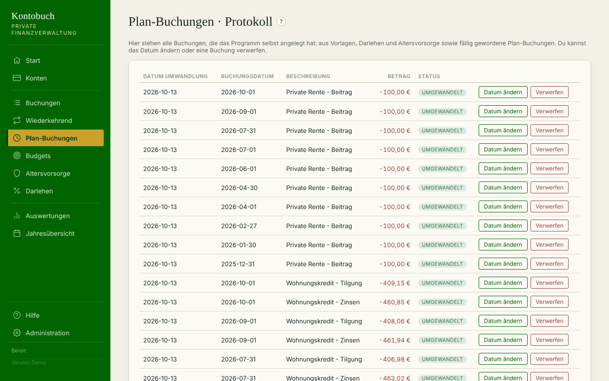

**Siehe auch:** [Wann wird gebucht?](#wiederkehrend.automatik), [Vorlagen ändern, pausieren, löschen](#wiederkehrend.verwalten)

## Budgets
<!-- kapitel: budgets -->

Mit Budgets behältst du im Blick, wie viel du in einem Bereich ausgibst, einnimmst oder sparst.

### Budget anlegen
<!-- kapitel: budgets.anlegen -->
<!-- stichworte: Budget, Warnschwelle, Zeitraum, Ampel -->

**Wofür?** Du legst fest, wie viel du zum Beispiel im Monat für Lebensmittel ausgeben willst. Das Programm zeigt dir, wie viel davon schon weg ist.

**So geht's**

1. Öffne „Budgets“ und dort den Reiter „Neues Budget“.
2. Trag einen „Name“ ein und wähle den „Typ“: „Ausgabe“ oder „Einnahme“.
3. Wähle die „Kategorie“. Lass „inkl. Unterkategorien“ angehakt, wenn auch die Unterkategorien zählen sollen.
4. Trag den „Betrag je Periode (€)“ ein.
5. Wähle den „Zeitraum“: „Monatlich“, „Quartalsweise“, „Jährlich“ oder „Benutzerdefiniert“. Bei „Benutzerdefiniert“ legst du mit „Alle …“ und „Einheit“ selbst fest, wie lang eine Periode ist.
6. Wähle das „Startdatum“ und bei Bedarf ein „Enddatum (optional)“.
7. Trag bei „Warnschwellen (%, komma-separiert)“ ein, ab wann du gewarnt werden willst, zum Beispiel 80.
8. Wähle bei Bedarf eine „Person (optional)“.
9. Klicke auf „Anlegen“.

**Gut zu wissen**

- Die Kategorie-Auswahl zeigt nur Kategorien, die zum gewählten Typ passen.
- Die Ampel ist grün, bis die niedrigste Warnschwelle erreicht ist. Dann wird sie gelb, ab 100 % rot.
- Mit „Inflationsfaktor“ wächst der Betrag je Periode mit dem Inflationsfaktor aus der Administration, gerechnet ab dem Startdatum.
- Überschneiden sich zwei Budgets in ihren Kategorien, steht das auf der Budget-Karte.

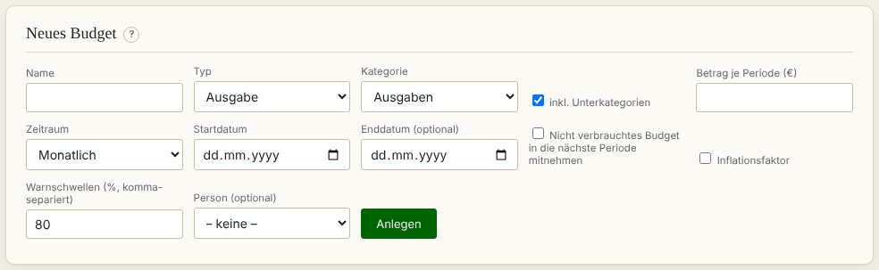

**Siehe auch:** [Übertrag und Deckel](#budgets.uebertrag), [Übersicht und Ampel](#budgets.uebersicht)

### Übertrag und Deckel
<!-- kapitel: budgets.uebertrag -->
<!-- stichworte: Übertrag, Deckel, Puffer, Ansparen -->

**Wofür?** Was du in einer Periode nicht verbrauchst, nimmst du in die nächste mit. So kannst du auch seltene, größere Ausgaben aus einem Budget bezahlen.

**So geht's**

1. Öffne das Budget im Reiter „Neues Budget“ oder lege ein neues an.
2. Hake „Nicht verbrauchtes Budget in die nächste Periode mitnehmen“ an.
3. Wähle bei „Wie soll weitergerechnet werden?“:
   - „Nur in die nächste Periode“: Der Rest einer Periode kommt einmal dazu.
   - „Fortlaufend ansparen“: Reste sammeln sich über alle Perioden an.
4. Trag bei „Fortlaufend ansparen“ bei Bedarf einen „Deckel für den Übertrag (€, optional)“ ein.
5. Klicke auf „Anlegen“ oder „Änderung speichern“.

**Gut zu wissen**

- Der Deckel begrenzt nur das Angesparte. Ein überzogenes Budget trägt die Überschreitung weiter, ohne Begrenzung.
- Beispiel: Ein Auto-Budget von 250 € im Monat mit Deckel 1.500 €. Es bezahlt Tanken, TÜV und Reparaturen, wächst aber nicht endlos, wenn lange nichts kaputtgeht.
- Ist ein Deckel gesetzt, zeigt die Karte „Puffer … von max. …“.

**Siehe auch:** [Budget anlegen](#budgets.anlegen)

### Sparziel anlegen
<!-- kapitel: budgets.sparziel -->
<!-- stichworte: Sparziel, Trägerkonto, Zielbetrag, Entnahme, Einzahlung -->

**Wofür?** Du sparst auf etwas hin, zum Beispiel einen Urlaub. Das Programm zeigt dir, ob du im Plan liegst.

**So geht's**

1. Öffne „Budgets“ und dort den Reiter „Neues Budget“.
2. Wähle als „Typ“ „Sparziel“.
3. Wähle das „Trägerkonto“. Das ist das Konto, auf dem das Geld liegt, zum Beispiel dein Tagesgeld.
4. Trag den „Zielbetrag (€)“ und bei Bedarf ein „Zieldatum (optional)“ ein.
5. Trag bei „Betrag je Periode (€)“ ein, wie viel du je Periode sparen willst.
6. Klicke auf „Anlegen“.
7. Ordne ab jetzt deine Sparüberweisungen dem Sparziel zu: bei einer Übertragung oder einer Umbuchungs-Vorlage unter „Sparziel zuordnen (optional)“.

**Gut zu wissen**

- Zum Sparziel zählen nur Übertragungen von oder zu seinem Trägerkonto. Geld auf das Trägerkonto zählt als Einzahlung, Geld vom Trägerkonto als Entnahme.
- Trägerkonto und Typ eines Sparziels lassen sich nicht mehr ändern, sobald Buchungen oder Vorlagen zugeordnet sind. Willst du das Konto wechseln, buche den Stand per Entnahme ab und per Einzahlung auf ein neues Sparziel.
- Auf der Startseite zeigt die Karte des Trägerkontos den Teil für das Sparziel und was „Frei verfügbar“ ist.
- Die Karte des Sparziels zeigt „Angespart … von …“ und ob du beim „Soll bis heute“ im Plan oder im Rückstand bist.

**Siehe auch:** [Übertragung zwischen Konten](#buchungen.uebertragung), [Sparziele prüfen](#admin.sparziele)

### Übersicht und Ampel
<!-- kapitel: budgets.uebersicht -->
<!-- stichworte: Budget-Übersicht, Fix-Prognose, Trend-Prognose, Verbrauch -->

**Wofür?** Du siehst alle Budgets mit ihrem Verbrauch in der laufenden Periode.

**So geht's**

1. Öffne „Budgets“ und dort den Reiter „Übersicht“.
2. Das Diagramm „Budget-Übersicht“ zeigt je Budget eine Säule.
3. Darunter stehen unter „Alle Budgets“ die Karten. Wähle oben rechts eine Person, wenn du nur ihre Budgets sehen willst.
4. Klicke auf einer Karte auf „Ändern“ oder „Löschen“.

**Gut zu wissen**

<!-- hinweis: budgets.uebersicht -->
Je aktivem Budget der Verbrauch der laufenden Periode in Prozent des verfügbaren Betrags, Übertrag eingerechnet. Die Farbe zeigt die Ampel.
<!-- /hinweis -->

- Eine Karte zeigt „Verbraucht … von …“, den „Rest“ und eine „Prognose“ bis zum Ende der Periode.

<!-- hinweis: budgets.prognose -->
Fix-Prognose: bisheriger Verbrauch plus die bekannten festen Buchungen bis Periodenende, ohne Schätzung. Trend-Prognose: zusätzlich ein geschätzter Anteil aus früheren Perioden, sobald genug Daten da sind.
<!-- /hinweis -->

- Sparziele zeigt das Diagramm nicht. Sie stehen nur als Karte in der Liste.

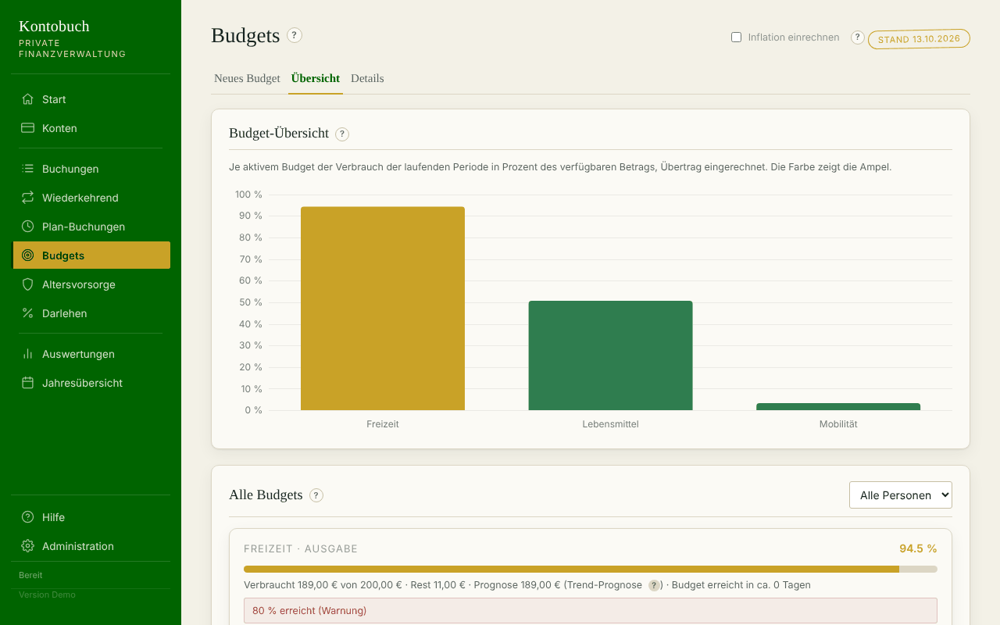

**Siehe auch:** [Details ansehen](#budgets.details), [Inflation einrechnen](#auswertungen.inflation)

### Details ansehen
<!-- kapitel: budgets.details -->
<!-- stichworte: Budget-Details, Monatsverlauf -->

**Wofür?** Du siehst Monat für Monat, wie sich ein Budget entwickelt hat und wie es weitergeht.

**So geht's**

1. Öffne „Budgets“ und dort den Reiter „Details“.
2. Wähle bei „Budget“ ein einzelnes Budget oder „Alle“.
3. Wähle den „Zeitraum“: „Standard (25 Monate)“ oder „Benutzerdefiniert“ mit „Von“ und „Bis“.
4. Bei einem einzelnen Budget stehen unter dem Diagramm die zugehörigen Buchungen.

**Gut zu wissen**

<!-- hinweis: budgets.details -->
Bis zum laufenden Monat siehst du echte Buchungen, danach die Prognose aus Vorlagen und Darlehensraten (heller). Im laufenden Monat sitzen die noch anstehenden Termine hell auf dem bisherigen Verbrauch.
<!-- /hinweis -->

- „Standard (25 Monate)“ zeigt die letzten 12 Monate, den laufenden und die nächsten 12.

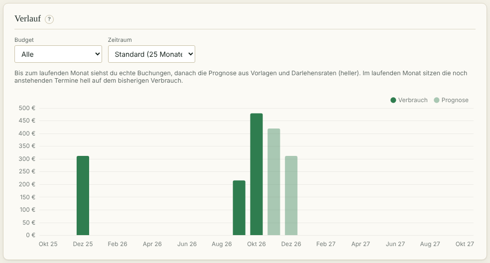

**Siehe auch:** [Übersicht und Ampel](#budgets.uebersicht)

## Darlehen
<!-- kapitel: darlehen -->

Hier verwaltest du Kredite mit Auszahlungen, Raten und Sondertilgungen.

### Darlehen anlegen
<!-- kapitel: darlehen.anlegen -->
<!-- stichworte: Darlehen, Kredit, Zinsbindung, Ratenmodus, Tilgungssatz, feste Rate -->

**Wofür?** Das Programm rechnet den Tilgungsplan und bucht Zinsen und Tilgung jeden Monat von selbst.

**So geht's**

1. Öffne „Darlehen“.
2. Fülle im Block „Neues Darlehen“ die Felder aus: „Bezeichnung“, „Darlehenssumme (€)“, „Zinssatz (% p.a.)“, „Zinsbeginn“, „Tilgungsbeginn“, „Laufzeit (Jahre)“, „Ende Zinsbindung“ und „Anschlusszinssatz (%)“.
3. Wähle den „Ratenmodus“: „Feste Rate (€)“ mit „Feste Rate (€/Monat)“ oder „Tilgungssatz (%)“ mit „Tilgungssatz (% p.a.)“. Beides steht im Kreditvertrag.
4. Wähle das „Zahlungskonto“, von dem die Raten abgehen, und bei Bedarf eine „Person (optional)“.
5. Klicke auf „Anlegen“.
6. Das Programm fragt im Fenster „Erste Auszahlung“ nach Datum und Betrag. Klicke auf „Buchen“ oder auf „Überspringen“, wenn noch nichts ausgezahlt ist.

**Gut zu wissen**

- Bis zum „Tilgungsbeginn“ zahlst du nur Zinsen.
- Nach dem „Ende Zinsbindung“ rechnet das Programm mit dem „Anschlusszinssatz“. Kennst du ihn noch nicht, trag eine Schätzung ein.
- Die Raten bucht das Programm als zwei Buchungen: „Darlehens-Zinsen“ und „Tilgung“ unter der Kategorie „Darlehen“.
- Die Rate tilgt nie mehr als die Restschuld. Die letzte Rate ist entsprechend kleiner.
- Nach dem Speichern nennt das Programm Raten der nächsten 12 Monate, die auf einen Feiertag fallen.

**Siehe auch:** [Auszahlung erfassen](#darlehen.auszahlung), [Tilgungsplan ansehen](#darlehen.tilgungsplan)

### Auszahlung erfassen
<!-- kapitel: darlehen.auszahlung -->
<!-- stichworte: Auszahlung, Teilauszahlung, Baufinanzierung -->

**Wofür?** Bei einer Baufinanzierung kommt das Geld oft in Teilen. Jede Auszahlung erfasst du einzeln.

**So geht's**

1. Öffne „Darlehen“.
2. Klicke auf der Karte des Darlehens auf „Auszahlung“.
3. Wähle das „Datum“ und trag den „Betrag (€)“ ein.
4. Klicke auf „Buchen“.

**Gut zu wissen**

- Die Auszahlung wird auf dem Zahlungskonto gebucht. Ohne Zahlungskonto wird sie nur am Darlehen vermerkt.
- Die Karte zeigt, wie viel schon ausgezahlt ist und wie viel noch fehlt.
- Zinsen fallen nur auf den ausgezahlten Betrag an.

**Siehe auch:** [Darlehen anlegen](#darlehen.anlegen)

### Sondertilgung buchen
<!-- kapitel: darlehen.sondertilgung -->
<!-- stichworte: Sondertilgung, Restschuld -->

**Wofür?** Du zahlst außer der Reihe etwas zurück. Die Restschuld sinkt sofort.

**So geht's**

1. Öffne „Darlehen“.
2. Klicke auf der Karte des Darlehens auf „Sondertilgung“.
3. Wähle das „Konto“, von dem du zahlst. Vorbelegt ist das Zahlungskonto.
4. Wähle das „Datum“ und trag den „Betrag (€)“ ein.
5. Klicke auf „Buchen“.

**Gut zu wissen**

- Bei fester Rate bleibt die Rate gleich. Das Darlehen ist dadurch früher abbezahlt.
- Künftige Sondertilgungen kennt das Programm nicht. Prognosen rechnen nur mit den schon gebuchten.

**Siehe auch:** [Tilgungsplan ansehen](#darlehen.tilgungsplan), [Darlehen auswerten](#auswertungen.darlehen)

### Tilgungsplan ansehen
<!-- kapitel: darlehen.tilgungsplan -->
<!-- stichworte: Tilgungsplan, Restschuld, Zahlungen -->

**Wofür?** Du siehst, wie die Restschuld über die Laufzeit sinkt, und alle Zahlungen zu einem Darlehen.

**So geht's**

1. Öffne „Darlehen“.
2. Klicke auf die Karte des Darlehens, nicht auf einen der Knöpfe.
3. Unten erscheint der Block „Tilgungsplan“ mit dem Verlauf der Restschuld.
4. Darunter stehen die „Zahlungen dieses Darlehens“.

**Gut zu wissen**

- Mehr Zahlen, etwa Zinsen je Jahr, findest du unter Auswertungen im Reiter „Darlehen“.

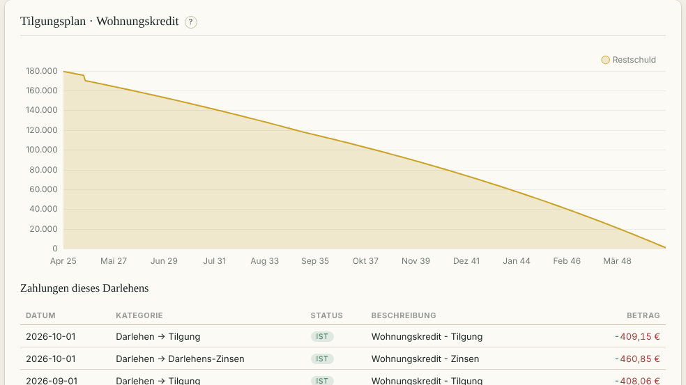

**Siehe auch:** [Darlehen auswerten](#auswertungen.darlehen)

### Darlehen ändern
<!-- kapitel: darlehen.aendern -->
<!-- stichworte: Darlehen ändern, Darlehenssumme -->

**Wofür?** Du korrigierst Eckdaten, zum Beispiel nach einer neuen Zinsvereinbarung.

**So geht's**

1. Öffne „Darlehen“.
2. Klicke auf der Karte des Darlehens auf „Ändern“. Das Formular oben füllt sich.
3. Ändere die Werte und klicke auf „Änderung speichern“. Mit „Änderung verwerfen“ brichst du ab.

**Gut zu wissen**

- Erfasste Auszahlungen und Sondertilgungen bleiben beim Ändern erhalten.
- Schon gebuchte Raten bleiben, wie sie sind. Die Änderung wirkt auf künftige Raten.
- Ein Darlehen löschst du unter Administration bei „Daten zurücksetzen“.

**Siehe auch:** [Darlehen, Altersvorsorge und Vorlagen löschen](#zuruecksetzen.vertraege)

## Altersvorsorge
<!-- kapitel: altersvorsorge -->

Hier erfasst du Rentenversicherungen, Kapitallebensversicherungen und ähnliche Verträge.

### Vertrag anlegen
<!-- kapitel: altersvorsorge.anlegen -->
<!-- stichworte: Altersvorsorge, Rentenversicherung, Beitrag, Rente, Einmalzahlung, Beitragsdynamik -->

**Wofür?** Das Programm bucht deine Beiträge und später die Rente von selbst und zeigt, was der Vertrag bringt.

**So geht's**

1. Öffne „Altersvorsorge“.
2. Trag im Block „Neue Altersvorsorge“ die „Bezeichnung“ ein, bei Bedarf „Anbieter/Vertragsnummer (optional)“.
3. Wähle das „Zahlungskonto“ und bei Bedarf eine „Person (optional)“.
4. Trag bei „Stand der Information“ das Datum deiner letzten Standmitteilung ein.
5. Zahlst du selbst ein? Hake „Es gibt eigene Einzahlungen“ an und fülle im Bereich „Einzahlung“ „Beitrag (€)“, „Beitrags-Kategorie“, „Intervall“, „Tag des Monats“ und „Beitragsstart“ aus. Steigt der Beitrag regelmäßig, hake „Beitragsdynamik“ an und trag „Rhythmus (Jahre)“ und „Steigerung (% je Zyklus)“ ein.
6. Fülle im Bereich „Auszahlung“ den „Rentenbeginn“ aus und wähle die „Auszahlungsart“: „Rente“ oder „Einmalzahlung“.
7. Trag die Beträge aus der Standmitteilung ein: „Rente garantiert (€/Monat)“ und „Rente voraussichtlich (€/Monat)“ oder die Werte für die Einmalzahlung.
8. Klicke auf „Anlegen“.

**Gut zu wissen**

- Ohne Häkchen bei „Es gibt eigene Einzahlungen“ bucht das Programm nur die Auszahlungen. Das passt zum Beispiel zur Betriebsrente, die dein Arbeitgeber bezahlt.
- Als Kategorien schlägt das Programm „Altersvorsorge“ und „Rente“ vor.
- „Rückkaufswert“ und „Auszahlung bei Tod“ dienen nur zur Information.
- Steuern und Sozialabgaben auf die Rente rechnet das Programm nicht ein. Vorschlag: Trag den Betrag nach Abzügen ein, wenn du ihn kennst. Das ist keine Steuerberatung.

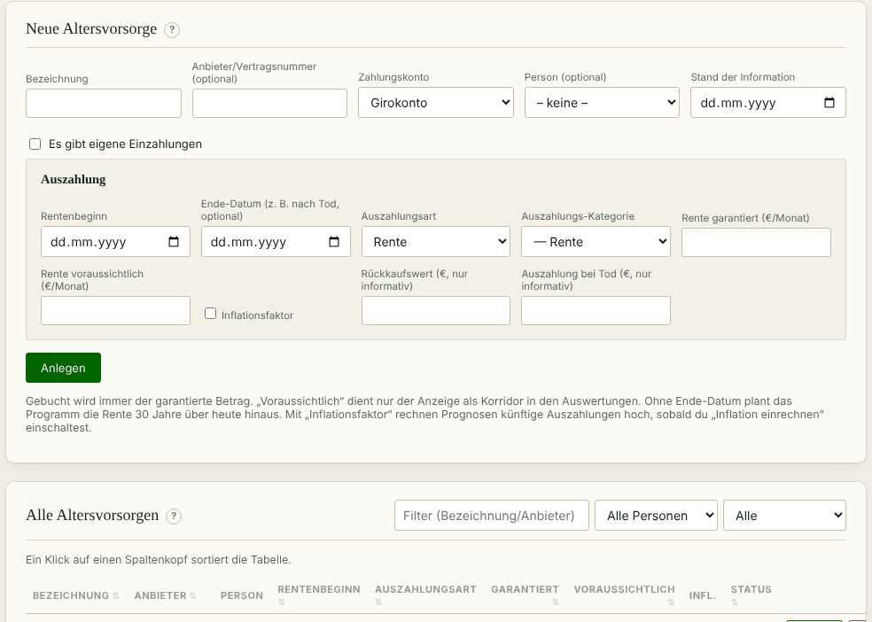

**Siehe auch:** [Garantiert und voraussichtlich](#altersvorsorge.betraege), [Altersvorsorge auswerten](#auswertungen.altersvorsorge)

### Garantiert und voraussichtlich
<!-- kapitel: altersvorsorge.betraege -->
<!-- stichworte: garantiert, voraussichtlich, Korridor, Planungshorizont -->

**Wofür?** Du verstehst, mit welchem Betrag das Programm bucht und rechnet.

**So geht's**

1. Trag beide Werte aus der Standmitteilung ein, den garantierten und den voraussichtlichen.
2. Schalte in den Auswertungen „Altersvorsorge-Korridor“ ein, wenn du die Spanne sehen willst.
3. Hake „Inflationsfaktor“ an, wenn künftige Auszahlungen mit der Inflation steigen sollen.

**Gut zu wissen**

<!-- hinweis: altersvorsorge.betraege -->
Gebucht wird immer der garantierte Betrag. „Voraussichtlich“ dient nur der Anzeige als Korridor in den Auswertungen. Ohne Ende-Datum plant das Programm die Rente 30 Jahre über heute hinaus. Mit „Inflationsfaktor“ rechnen Prognosen künftige Auszahlungen hoch, sobald du „Inflation einrechnen“ einschaltest.
<!-- /hinweis -->

- Ein „Ende-Datum (z. B. nach Tod, optional)“ beendet die Rentenzahlungen zu diesem Datum.

**Siehe auch:** [Saldo-Verlauf](#auswertungen.saldo), [Inflation einrechnen](#auswertungen.inflation)

### Rentenbeginn verschieben
<!-- kapitel: altersvorsorge.rentenbeginn -->
<!-- stichworte: Rentenbeginn, Phase, vorziehen -->

**Wofür?** Du gehst früher oder später in Rente als geplant. Das Programm räumt die Buchungen passend auf.

**So geht's**

1. Öffne „Altersvorsorge“ und klicke beim Vertrag auf „Ändern“.
2. Trag den neuen „Rentenbeginn“ ein.
3. Klicke auf „Änderung speichern“.
4. Lies den Dialog. Er nennt, wie viele automatisch gebuchte Zahlungen danach in der falschen Phase lägen.
5. Bestätige mit „OK“. Das Programm löscht diese Buchungen und bucht fehlende Beiträge oder Renten nach.

**Gut zu wissen**

- Falsche Phase heißt: Beiträge ab dem neuen Rentenbeginn oder Renten davor. Bei einer Einmalzahlung ist es die Zahlung am alten Datum.
- Buchungen, deren Datum du im Protokoll geändert hast, bleiben stehen. Der Dialog nennt sie, damit du sie selbst prüfen kannst.

**Siehe auch:** [Protokoll prüfen](#plan.protokoll)

### Verträge verwalten
<!-- kapitel: altersvorsorge.liste -->
<!-- stichworte: Vertragsliste, Vertrag ändern, Vertrag löschen -->

**Wofür?** Du findest einen Vertrag schnell wieder und hältst ihn aktuell.

**So geht's**

1. Öffne „Altersvorsorge“ und gehe zum Block „Alle Altersvorsorgen“.
2. Filtere bei Bedarf nach Bezeichnung oder Anbieter, Person und Status.
3. Klicke bei einem Vertrag auf „Ändern“, um ihn zu bearbeiten. Kommt eine neue Standmitteilung, trag die neuen Beträge und das neue „Stand der Information“ ein.
4. Klicke auf „Löschen“, um den Vertrag zu entfernen.

**Gut zu wissen**

- Ein Klick auf einen Spaltenkopf sortiert die Tabelle.
- Beim Löschen bleiben schon gebuchte Beiträge und Renten als Buchungen erhalten.

**Siehe auch:** [Vertrag anlegen](#altersvorsorge.anlegen)

## Auswertungen
<!-- kapitel: auswertungen -->

Die Auswertungen zeigen, wie sich deine Finanzen entwickelt haben und wie es weitergehen wird.

### Filter und Zeitraum
<!-- kapitel: auswertungen.filter -->
<!-- stichworte: Zeithorizont, Filter, Einheit, Prognose -->

**Wofür?** Du bestimmst, welchen Zeitraum und welche Konten oder Kategorien die Diagramme im Reiter „Allgemein“ zeigen.

**So geht's**

1. Öffne „Auswertungen“ und dort den Reiter „Allgemein“.
2. Klicke beim „Zeithorizont“ auf „1 J“, „5 J“, „10 J“, „20 J“ oder „30 J“. Mit „Frei“ trägst du „Von“ und „Bis“ selbst ein.
3. Wähle bei Bedarf unter „Konten“ und „Kategorien“ aus, was du sehen willst.
4. Klicke bei der „Einheit“ auf „€“ oder auf „k€“ für Tausend Euro.
5. Hake „inkl. Darlehen“ ab, wenn die Restschuld von Darlehen nicht mitzählen soll.

**Gut zu wissen**

<!-- hinweis: auswertungen.kategorie-filter -->
Mit einem Kategorie-Filter zeigt der Saldo-Verlauf nicht den Kontostand, sondern je gewählter Kategorie die aufsummierten Beträge, ohne Restschuld.
<!-- /hinweis -->

- Die Diagramme laden neu, sobald du etwas änderst. Einen Knopf zum Aktualisieren gibt es nicht.
- Dein Browser merkt sich Zeithorizont, Einheit, Konten und Kategorien für den nächsten Besuch.
- Bis heute zeigen die Diagramme echte Buchungen, danach die Prognose aus Vorlagen, Darlehen und Altersvorsorge.

**Siehe auch:** [Konten und Kategorien auswählen](#auswertungen.auswahl), [Saldo-Verlauf](#auswertungen.saldo)

### Konten und Kategorien auswählen
<!-- kapitel: auswertungen.auswahl -->
<!-- stichworte: Mehrfachauswahl, Kontenauswahl, Kategorienauswahl, Unterkategorie, Alle, Keine -->

**Wofür?** Du wertest mehrere Konten oder Kategorien gemeinsam aus, zum Beispiel nur „Wohnen“ und „Kraftstoff“.

**So geht's**

1. Klicke auf das Feld „Konten“ oder „Kategorien“. Eine Liste mit Häkchen öffnet sich.
2. Setze oder entferne die Häkchen. „Alle“ und „Keine“ setzen oder entfernen alle auf einmal.
3. Bei den Kategorien kannst du oben im Suchfeld einen Namen eintippen. Die Liste zeigt dann nur passende Kategorien.
4. Klicke neben die Liste oder drücke die Taste Esc, um sie zu schließen.

**Gut zu wissen**

- Ein Häkchen an einer Oberkategorie wählt alle ihre Unterkategorien mit. Nimmst du eine davon wieder heraus, zeigt die Oberkategorie „–“.
- Im Feld stehen die gewählten Konten oder Kategorien als kleine Schilder, bei vielen nur die ersten zwei und „+“ mit der Anzahl der übrigen.
- Konten wirken sofort. Kategorien wirken, sobald du die Liste schließt.
- Ist nichts gewählt, zeigt die Seite statt der Diagramme einen Hinweis.
- Dieselbe Auswahl gibt es in der Jahresübersicht.

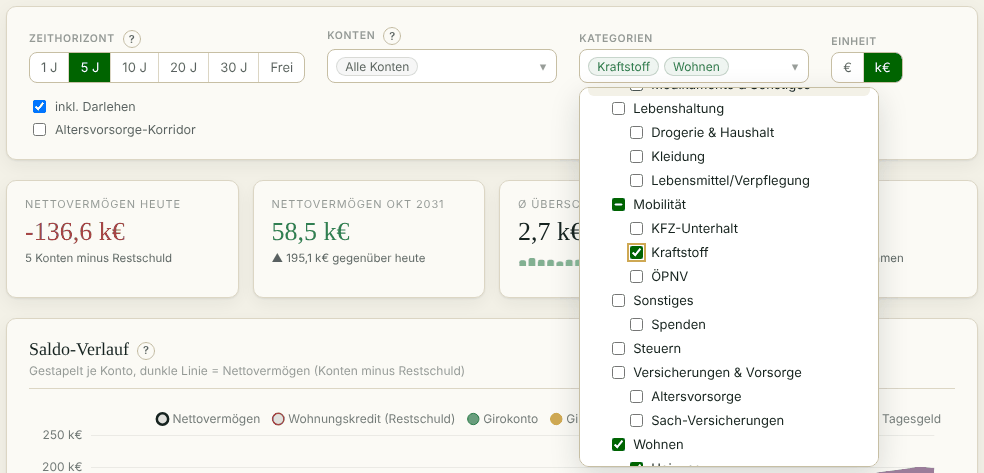

**Siehe auch:** [Filter und Zeitraum](#auswertungen.filter), [Jahresübersicht lesen](#jahr.lesen)

### Kennzahlen
<!-- kapitel: auswertungen.kennzahlen -->
<!-- stichworte: Kennzahlen, Vermögen, Nettovermögen, Überschuss, Sparquote -->

**Wofür?** Vier Kacheln über den Diagrammen fassen den gewählten Zeitraum in Zahlen zusammen.

**So geht's**

1. Öffne „Auswertungen“, Reiter „Allgemein“.
2. Lies die Kacheln über dem „Saldo-Verlauf“.

**Gut zu wissen**

- „Vermögen heute“ ist die Summe der gewählten Konten. Mit „inkl. Darlehen“ zieht das Programm die Restschuld ab und nennt die Kachel „Nettovermögen heute“.
- Die zweite Kachel zeigt denselben Wert am Ende des Zeitraums und den Unterschied zu heute.
- „Ø Überschuss je Monat“ ist Einnahmen minus Ausgaben im Zeitraum, geteilt durch die Zahl der Monate. Die kleinen Balken darunter zeigen den Überschuss je Abschnitt des Cashflows.
- „Sparquote“ ist der Überschuss geteilt durch die Einnahmen.
- Mit einem Kategorie-Filter zeigen die ersten beiden Kacheln die Einnahmen und Ausgaben der gewählten Kategorien im Zeitraum.

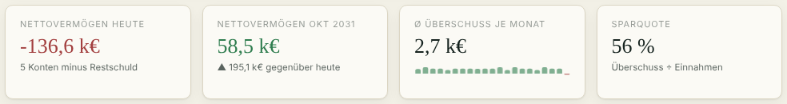

**Siehe auch:** [Cashflow](#auswertungen.cashflow), [Saldo-Verlauf](#auswertungen.saldo)

### Saldo-Verlauf
<!-- kapitel: auswertungen.saldo -->
<!-- stichworte: Saldo-Verlauf, Kontostand, Altersvorsorge-Korridor -->

**Wofür?** Du siehst, wie sich der Stand deiner Konten über die Zeit entwickelt.

**So geht's**

1. Öffne „Auswertungen“, Reiter „Allgemein“.
2. Lies den Block „Saldo-Verlauf“. Jedes Konto ist eine farbige Fläche, die Flächen liegen übereinander.
3. Die dunkle Linie zeigt das Nettovermögen, also alle Konten minus Restschuld. Ohne Darlehen oder ohne „inkl. Darlehen“ zeigt sie die Summe der Konten.
4. Die Restschuld jedes Darlehens ist eine rote gestrichelte Linie unter null.
5. Hake „Altersvorsorge-Korridor“ an, wenn du sehen willst, wie es mit den voraussichtlichen statt den garantierten Renten aussähe. Eine goldene gestrichelte Linie zeigt das.
6. Fahre mit der Maus über das Diagramm. Ein Kasten zeigt alle Werte des Monats.

**Gut zu wissen**

- Der laufende Monat zählt schon die Termine bis Monatsende mit.
- Beginnt der Zeitraum in der Vergangenheit, markiert eine senkrechte Linie „heute“.
- Ein Klick auf einen Eintrag der Legende blendet ihn aus und wieder ein.
- Mit einem Kategorie-Filter ist jede gewählte Kategorie eine eigene Fläche über alle gewählten Konten. Eine ganz gewählte Oberkategorie ist eine Fläche, eine teilweise gewählte heißt „(teilweise)“.


**Siehe auch:** [Filter und Zeitraum](#auswertungen.filter), [Garantiert und voraussichtlich](#altersvorsorge.betraege)

### Cashflow
<!-- kapitel: auswertungen.cashflow -->
<!-- stichworte: Cashflow, Einnahmen, Ausgaben -->

**Wofür?** Du siehst, wie viel hereinkommt und wie viel hinausgeht.

**So geht's**

1. Öffne „Auswertungen“, Reiter „Allgemein“.
2. Lies den Block „Cashflow“. Grüne Säulen zeigen die Einnahmen nach oben, rote die Ausgaben nach unten.
3. Die dunkle Linie zeigt den Überschuss, also Einnahmen minus Ausgaben.
4. Fahre mit der Maus über eine Säule, um die Werte zu sehen.

**Gut zu wissen**

- Bis 2 Jahre zeigt das Diagramm Monate, bis 10 Jahre Quartale, darüber Jahre. Die Zeile unter der Überschrift nennt die Stufe.
- Das erste und das letzte Quartal oder Jahr können angebrochen sein und wirken dann kleiner.
- Im laufenden Monat sitzen die noch anstehenden Termine hell auf dem bereits Gebuchten.
- Übertragungen zwischen deinen Konten zählen hier nicht.

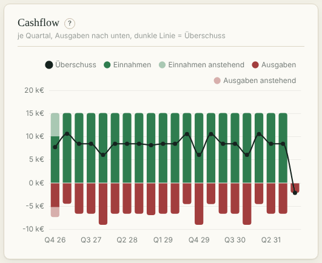

**Siehe auch:** [Jahresübersicht lesen](#jahr.lesen)

### Kategorien-Diagramm
<!-- kapitel: auswertungen.kategorien -->
<!-- stichworte: Kategorien-Diagramm, Hauptkategorie -->

**Wofür?** Du siehst, wofür das Geld im gewählten Zeitraum ausgegeben wurde und woher es kam.

**So geht's**

1. Öffne „Auswertungen“, Reiter „Allgemein“.
2. Wähle im Block „Kategorien“ oben rechts „Ausgaben“ oder „Einnahmen“.
3. Lies die Rangliste. Neben jedem Balken stehen Betrag und Anteil.
4. Fahre mit der Maus über einen Balken, um die Zahl der Buchungen und Termine zu sehen.

**Gut zu wissen**

<!-- hinweis: auswertungen.kategorien -->
Summen über den gewählten Zeitraum, anstehende Termine eingeschlossen. Die drei größten Posten sind kräftig gefärbt, ab Platz 13 fasst „Übrige“ den Rest zusammen.
<!-- /hinweis -->

- Hat eine Oberkategorie eigene Buchungen, zählt das Programm ihre direkten Unterkategorien zu ihr. Sonst steht jede Unterkategorie für sich.
- Darlehens-Zinsen und Tilgung zählen hier nicht, ebenso Übertragungen zwischen deinen Konten.

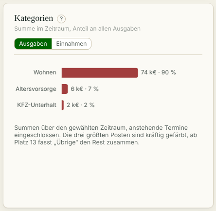

**Siehe auch:** [Filter und Zeitraum](#auswertungen.filter)

### Inflation einrechnen
<!-- kapitel: auswertungen.inflation -->
<!-- stichworte: Inflation, Inflation einrechnen, Hochrechnung -->

**Wofür?** Prognosen sollen berücksichtigen, dass Miete oder Rente mit der Zeit steigen.

**So geht's**

1. Markiere die Posten, die steigen sollen: bei einer Vorlage „Inflations-abhängig“, bei einer Altersvorsorge „Inflationsfaktor“.
2. Trag unter Administration den „Inflationsfaktor“ ein, zum Beispiel 2 %.
3. Hake auf der Seite, die du ansiehst, „Inflation einrechnen“ an. Den Schalter gibt es bei Auswertungen, Jahresübersicht, Budgets und in der Buchungsliste.

**Gut zu wissen**

<!-- hinweis: inflation.schalter -->
Rechnet Posten mit Inflations-Häkchen (Vorlagen, Rentenauszahlungen) in der Prognose mit dem Inflationsfaktor hoch. Echte Buchungen bleiben unverändert.
<!-- /hinweis -->

- Der Schalter ist beim Öffnen einer Seite immer aus. Dann siehst du die Beträge ohne Hochrechnung.
- Der Schalter gilt auf der Seite der Auswertungen für alle Reiter, auch für den Korridor.

**Siehe auch:** [Inflationsfaktor](#admin.inflationsfaktor)

### Darlehen auswerten
<!-- kapitel: auswertungen.darlehen -->
<!-- stichworte: Darlehensauswertung, Zinsen je Jahr, Restschuld-Verlauf -->

**Wofür?** Du siehst, wie viel Zinsen du zahlst und wann ein Darlehen abbezahlt ist.

**So geht's**

1. Öffne „Auswertungen“ und dort den Reiter „Darlehen“.
2. Wähle bei „Darlehen“ ein einzelnes oder „Alle Darlehen“.
3. Wähle den „Zeitraum (Diagramme und Jahrestabelle)“.
4. Lies die Kennzahlen, den „Restschuld-Verlauf“, „Zins und Tilgung je Jahr“ und die Tabelle „Je Darlehen“.

**Gut zu wissen**

<!-- hinweis: auswertungen.darlehen -->
Bis heute siehst du die gebuchten Zahlungen, danach den Tilgungsplan (heller oder als Prognose markiert). Künftige Sondertilgungen kennt das Programm nicht.
<!-- /hinweis -->

<!-- hinweis: auswertungen.zinsbindung -->
Die gestrichelte senkrechte Linie markiert das Ende der Zinsbindung.
<!-- /hinweis -->

- Der Zeitraum wirkt auf Diagramme und Jahrestabelle, nicht auf Kennzahlen und die Tabelle „Je Darlehen“.

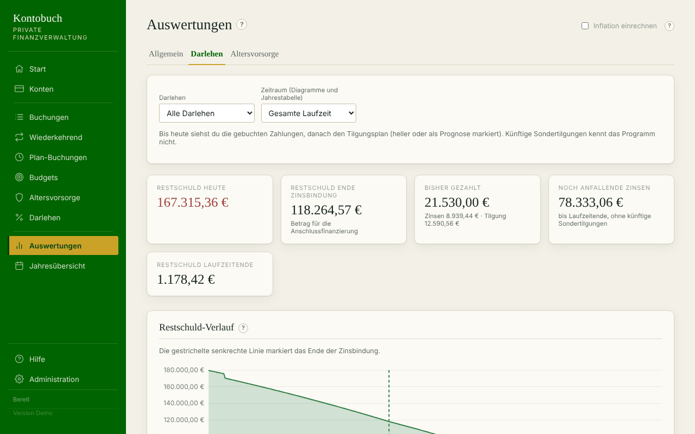

**Siehe auch:** [Tilgungsplan ansehen](#darlehen.tilgungsplan)

### Altersvorsorge auswerten
<!-- kapitel: auswertungen.altersvorsorge -->
<!-- stichworte: Altersvorsorge-Auswertung, Nulldurchgang, Standmitteilung -->

**Wofür?** Du siehst, was du einzahlst, was du herausbekommst und ab wann sich ein Vertrag rechnet.

**So geht's**

1. Öffne „Auswertungen“ und dort den Reiter „Altersvorsorge“.
2. Wähle bei „Vertrag“ einen einzelnen oder „Alle Verträge“.
3. Wähle den „Zeitraum (Diagramme und Jahrestabelle)“.
4. Lies die Kennzahlen, „Beiträge und Auszahlungen je Jahr“ und den „Kumulierten Verlauf“.

**Gut zu wissen**

<!-- hinweis: auswertungen.altersvorsorge -->
Bis heute siehst du die gebuchten Zahlungen, danach die Rechnung mit den garantierten Beträgen. Ohne Ende-Datum plant das Programm die Rente 30 Jahre über heute hinaus.
<!-- /hinweis -->

<!-- hinweis: auswertungen.aufsatz -->
Der helle Aufsatz zeigt, wie viel „voraussichtlich“ über „garantiert“ liegt.
<!-- /hinweis -->

<!-- hinweis: auswertungen.kumuliert -->
Summe der Auszahlungen minus Summe der Beiträge. Ab dem Nulldurchgang hat sich der Vertrag gerechnet.
<!-- /hinweis -->

- Ist eine Standmitteilung älter als 14 Monate, erscheint ein Hinweis. Trag dann die neuen Werte beim Vertrag ein.

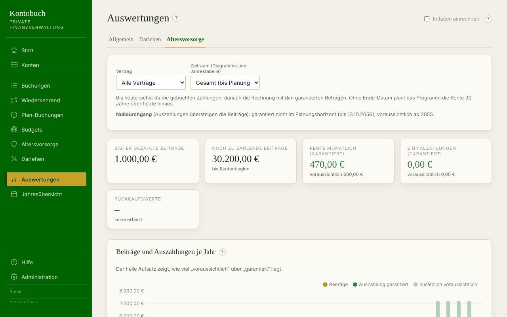

**Siehe auch:** [Garantiert und voraussichtlich](#altersvorsorge.betraege)

## Jahresübersicht
<!-- kapitel: jahr -->

Die Jahresübersicht zeigt Einnahmen und Ausgaben Monat für Monat.

### Jahresübersicht lesen
<!-- kapitel: jahr.lesen -->
<!-- stichworte: Jahresübersicht, Monatsverlauf, Kalenderjahr, rollierend -->

**Wofür?** Du siehst ein Jahr im Überblick und erkennst, in welchen Monaten viel ausgegeben wurde.

**So geht's**

1. Öffne „Jahresübersicht“.
2. Wähle den „Zeitraum“: „Rollierend 12 Monate“ für die letzten zwölf Monate bis heute oder „Kalenderjahr“ mit der Auswahl „Jahr“.
3. Wähle bei Bedarf unter „Konten“, „Kategorien“ oder „Person“ aus. Konten und Kategorien wählst du wie in den Auswertungen mit Häkchen.
4. Lies die Kennzahlen, den „Monatsverlauf“ mit Tabelle und die Tabelle „Nach Hauptkategorie“.

**Gut zu wissen**

- Der laufende Monat enthält die Termine bis Monatsende.
- „Nach Hauptkategorie“ fasst eine Ebene unter Einnahmen und Ausgaben zusammen, also zum Beispiel „Wohnen“ oder „Mobilität“.
- Auch hier gibt es den Schalter „Inflation einrechnen“.
- Dein Browser merkt sich die gewählten Konten und Kategorien.

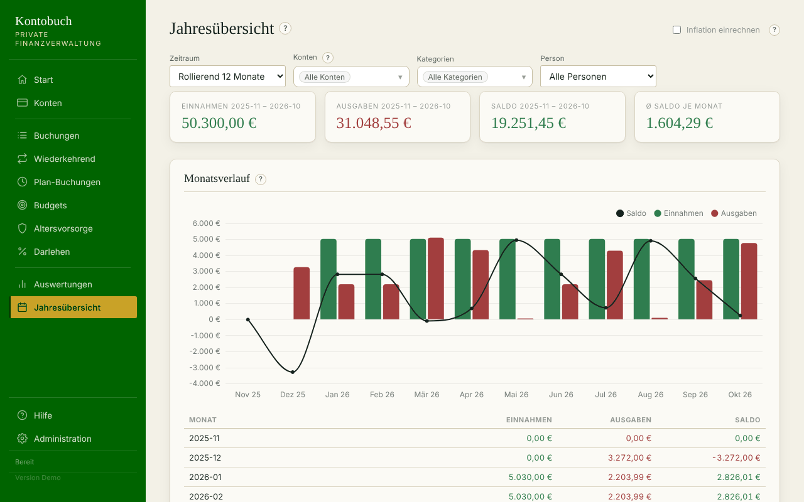

**Siehe auch:** [Cashflow](#auswertungen.cashflow), [Inflation einrechnen](#auswertungen.inflation)

## Schnellbuchung und Siri
<!-- kapitel: schnellbuchung -->

Unterwegs buchst du am schnellsten mit der Schnellbuchung oder per Sprachbefehl.

### Schnellbuchung nutzen
<!-- kapitel: schnellbuchung.nutzen -->
<!-- stichworte: Schnellbuchung, Handy, Rechnen im Betragsfeld -->

**Wofür?** Eine schlanke Eingabeseite für das Handy. Du buchst in wenigen Sekunden.

**So geht's**

1. Öffne die Schnellbuchung, zum Beispiel über ihren eigenen Eintrag in der Seitenleiste von Home Assistant.
2. Trag den „Betrag (€)“ ein. Du darfst rechnen, zum Beispiel 12,50+8,30.
3. Wähle „Konto“ und „Kategorie“ und schreib bei Bedarf eine „Beschreibung“.
4. Unter „Weitere Angaben“ findest du „Buchungstyp“, „Datum“, „Zielkonto“ und „Sparziel zuordnen“.
5. Klicke auf „Speichern“. Mit „Speichern & weiter“ bleiben Konto und Kategorie für die nächste Buchung stehen.

**Gut zu wissen**

- Die Seite merkt sich das zuletzt genutzte Konto und die Kategorie.
- Deine Siri-Favoriten stehen in der Kategorie-Auswahl ganz oben.
- Gibt es am selben Tag schon den gleichen Betrag auf dem Konto, erscheint ein Hinweis auf eine mögliche Doppelbuchung.
- Ist das gewählte Datum ein Feiertag, steht ein Hinweis unter dem Feld „Datum“.


**Siehe auch:** [Schnellbuchung in der Seitenleiste](#schnellbuchung.seitenleiste), [Siri-Favoriten festlegen](#schnellbuchung.favoriten)

### Schnellbuchung in der Seitenleiste
<!-- kapitel: schnellbuchung.seitenleiste -->
<!-- stichworte: Seitenleiste Home Assistant, panel_custom -->

**Wofür?** Die Schnellbuchung bekommt einen eigenen Eintrag in der Seitenleiste von Home Assistant.

**So geht's**

1. Öffne die Samba-Freigabe von Home Assistant und dort den Ordner config.
2. Lege dort den Ordner www an, falls es ihn noch nicht gibt.
3. Kopiere die Datei finanzen-schnellbuchung.js aus dem Ordner ha-integration des Add-ons nach config/www.
4. Ergänze in der Datei configuration.yaml:

```yaml
panel_custom:
  - name: finanzen-schnellbuchung-panel
    sidebar_title: Schnellbuchung
    sidebar_icon: mdi:cash-plus
    url_path: schnellbuchung
    module_url: /local/finanzen-schnellbuchung.js
    embed_iframe: false
    require_admin: false
```

5. Starte Home Assistant neu: Einstellungen, System, Symbol oben rechts, „Home Assistant neu starten“.

**Gut zu wissen**

- Der Eintrag funktioniert auch nach einer Neuinstallation des Add-ons weiter.
- Die Seite findet das Add-on von selbst, ob es lokal oder aus dem Repository installiert ist. Zeigt sie trotzdem eine Fehlermeldung, trage in finanzen-schnellbuchung.js ganz oben bei ADDON_SLUG die Kennung des Add-ons ein. Du findest sie in der Adresszeile des Browsers, wenn du in Home Assistant die Seite der App öffnest, zum Beispiel …/addon/local_finanzverwaltung/info.

**Siehe auch:** [Schnellbuchung nutzen](#schnellbuchung.nutzen)

### Siri: Zugangstoken erstellen
<!-- kapitel: schnellbuchung.siri-token -->
<!-- stichworte: Siri, Zugangstoken, Token -->

**Wofür?** Siri braucht einen Schlüssel, um Home Assistant etwas buchen zu lassen.

**So geht's**

1. Klicke in Home Assistant unten links auf deinen Benutzernamen.
2. Öffne den Reiter „Sicherheit“ und gehe ganz nach unten zu „Langlebige Zugangstoken“.
3. Klicke auf „Token erstellen“ und gib ihm einen Namen, zum Beispiel Siri Finanzen.
4. Kopiere den Token sofort. Er wird nur einmal angezeigt.

**Gut zu wissen**

- Bewahre den Token sicher auf. Wer ihn hat, kann Home Assistant steuern.

**Siehe auch:** [Siri: Home Assistant vorbereiten](#schnellbuchung.siri-ha)

### Siri: Home Assistant vorbereiten
<!-- kapitel: schnellbuchung.siri-ha -->
<!-- stichworte: rest_command, configuration.yaml -->

**Wofür?** Home Assistant nimmt den Auftrag von Siri entgegen und leitet ihn an die Finanzverwaltung weiter.

**So geht's**

1. Ergänze in der Datei configuration.yaml diese beiden Einträge:

```yaml
rest_command:
  finanz_buchung:
    url: "http://local-finanzverwaltung:8099/api/siri/buchung"
    method: POST
    content_type: "application/json"
    payload: >-
      {"betrag": {{ betrag }},
       "kategorie": "{{ kategorie | default('') }}",
       "konto": "{{ konto | default('') }}",
       "beschreibung": "{{ beschreibung | default('') }}"}

rest:
  - resource: "http://local-finanzverwaltung:8099/api/siri/favoriten"
    scan_interval: 300
    sensor:
      - name: "Finanz Kategorien"
        value_template: "{{ value_json | map(attribute='name') | list | join(', ') }}"
  - resource: "http://local-finanzverwaltung:8099/api/konten"
    scan_interval: 300
    sensor:
      - name: "Finanz Konten"
        value_template: "{{ value_json | map(attribute='name') | list | join(', ') }}"
```

2. Passe in allen drei Adressen den Namen local-finanzverwaltung an, falls dein Add-on anders heißt. Er ist die Kennung des Add-ons mit Bindestrich statt Unterstrich. Die Kennung steht in der Adresszeile des Browsers auf der Seite der App, zum Beispiel …/addon/local_finanzverwaltung/info. Aus dem Repository installiert beginnt sie statt mit local mit einer Zeichenfolge aus Buchstaben und Ziffern.
3. Prüfe die Datei: Entwicklerwerkzeuge, YAML, „Konfiguration prüfen“.
4. Starte Home Assistant neu.
5. Teste: Entwicklerwerkzeuge, Aktionen, rest_command.finanz_buchung mit betrag 12.50, kategorie Lebensmittel/Verpflegung und konto mit dem Namen deines Kontos.

**Gut zu wissen**

- Die beiden Sensoren unter rest sind freiwillig. Du brauchst sie, wenn Siri Konto und Kategorie zur Auswahl anbieten soll.

**Siehe auch:** [Siri: Kurzbefehl anlegen](#schnellbuchung.siri-kurzbefehl)

### Siri: Kurzbefehl anlegen
<!-- kapitel: schnellbuchung.siri-kurzbefehl -->
<!-- stichworte: Kurzbefehl, Kurzbefehle-App, Sprachbefehl -->

**Wofür?** Mit „Hey Siri, Ausgabe buchen“ erfasst du eine Ausgabe per Sprache.

**So geht's**

1. Öffne auf dem iPhone die App „Kurzbefehle“ und lege einen neuen Kurzbefehl an.
2. Füge die Aktion „Inhalte von URL abrufen“ hinzu.
3. Trag als URL http://homeassistant.local:8123/api/services/rest_command/finanz_buchung ein und wähle die Methode POST.
4. Lege zwei Header an: Schlüssel Authorization mit dem Wert Bearer und dahinter deinem Token, Schlüssel Content-Type mit dem Wert application/json.
5. Stelle den Anfragetext auf „JSON“ und lege die Felder betrag, kategorie und konto an, bei Bedarf auch beschreibung.
6. Soll Siri nach dem Betrag fragen, füge davor „Nach Eingabe fragen“ mit dem Typ Zahl ein und setze das Ergebnis bei betrag ein.
7. Benenne den Kurzbefehl, zum Beispiel „Ausgabe buchen“.

**Gut zu wissen**

- Die Schlüssel müssen genau kleingeschrieben sein: betrag, kategorie, konto, beschreibung.
- Ein Konto muss immer dabei sein. Ohne Konto bucht das Programm nicht und meldet einen Fehler.
- Ein Name, der auf mehrere Konten passt, zum Beispiel „Giro“ bei zwei Girokonten, ergibt eine Fehlermeldung mit den passenden Namen.
- Für mehrere Personen legst du mehrere Kurzbefehle mit jeweils eigenem Konto an.
- Ohne Kategorie greifen die Regeln der automatischen Kategorisierung.

**Siehe auch:** [Siri: Konto und Kategorie auswählen lassen](#schnellbuchung.siri-auswahl), [Automatische Kategorisierung](#admin.regeln)

### Siri: Konto und Kategorie auswählen lassen
<!-- kapitel: schnellbuchung.siri-auswahl -->
<!-- stichworte: Auswahlliste, Sensor -->

**Wofür?** Siri bietet dir bei jeder Buchung deine Konten und Lieblingskategorien zur Auswahl an.

**So geht's**

Für das Konto und für die Kategorie baust du je vier Aktionen vor die Buchungsaktion:

1. „Inhalte von URL abrufen“ mit der URL http://homeassistant.local:8123/api/states/sensor.finanz_konten oder sensor.finanz_kategorien, Methode GET und dem Header Authorization wie beim Buchen.
2. „Wörterbuchwert abrufen“ mit dem Schlüssel state.
3. „Text aufteilen“ mit dem eigenen Trennzeichen Komma und Leerzeichen.
4. „Aus Liste auswählen“ mit dem Ergebnis von Schritt 3.
5. Setze das ausgewählte Konto bzw. die ausgewählte Kategorie im Anfragetext bei konto bzw. kategorie ein.

**Gut zu wissen**

- Benenne die Ergebnisse um, zum Beispiel GewähltesKonto und GewählteKategorie. Tippe dazu auf das blaue Ergebnisfeld und wähle „Variable umbenennen“. Sonst verwechselst du sie leicht.
- Die Kategorienliste enthält nur deine Siri-Favoriten.
- Die Listen werden alle fünf Minuten aktualisiert. Ein neuer Favorit erscheint also mit etwas Verzögerung.

**Siehe auch:** [Siri-Favoriten festlegen](#schnellbuchung.favoriten)

### Siri: Wenn etwas nicht klappt
<!-- kapitel: schnellbuchung.siri-fehler -->
<!-- stichworte: Siri Fehler, Heimnetz, VPN, mehrdeutig -->

**Wofür?** Du findest die häufigsten Fehler schnell.

**So geht's**

1. Kommt die Kategorie oder das Konto leer an? Prüfe, ob die Schlüssel im Anfragetext kleingeschrieben sind.
2. Steht im Feld kategorie plötzlich eine Zahl? Dann ist die falsche Variable verknüpft. Benenne die Variablen um und verknüpfe sie neu.
3. Klappt es unterwegs nicht? Die Kurzbefehle funktionieren nur im heimischen WLAN, wenn Home Assistant von außen nicht erreichbar ist.
4. Meldet das Programm „mehrdeutig“? Der Name passt zu mehreren Kategorien, zum Beispiel „Zinsen“ zu „Darlehens-Zinsen“ und „Zinsen & Kapitalerträge“. Nenne den Namen vollständig.

**Gut zu wissen**

- Das Programm sucht zuerst den genauen Namen, dann einen eindeutigen Teil des Namens. Groß- und Kleinschreibung spielen keine Rolle.
- Für unterwegs brauchst du einen Fernzugang zu Home Assistant, zum Beispiel Home Assistant Cloud oder ein eigenes VPN.
- Ein „Wenn“-Baustein im Kurzbefehl kann außerhalb des WLANs eine verständliche Meldung ausgeben.

**Siehe auch:** [Siri: Kurzbefehl anlegen](#schnellbuchung.siri-kurzbefehl)

### Siri-Favoriten festlegen
<!-- kapitel: schnellbuchung.favoriten -->
<!-- stichworte: Siri-Favoriten, Favoriten -->

**Wofür?** Deine wichtigsten Kategorien stehen in Siri und in der Schnellbuchung ganz oben.

**So geht's**

1. Öffne „Administration“, Reiter „Stammdaten“, Block „Siri & Schnellbuchung“.
2. Hake die Kategorien an, die du oft brauchst.

**Gut zu wissen**

<!-- hinweis: admin.siri -->
Favoriten stehen im Siri-Kurzbefehl und in der Schnellbuchung ganz oben. Der Kurzbefehl muss immer ein Konto mitschicken, sonst meldet Siri einen Fehler.
<!-- /hinweis -->

- Wähle lieber wenige Favoriten, damit die Liste in Siri übersichtlich bleibt.

**Siehe auch:** [Siri: Konto und Kategorie auswählen lassen](#schnellbuchung.siri-auswahl)

## Administration
<!-- kapitel: admin -->

Hier stellst du Dinge ein, die du selten brauchst. Die Administration hat drei Reiter: „Stammdaten“, „System“ und „Daten zurücksetzen“. Ein Klick auf die Überschrift eines Blocks klappt ihn auf.

### Personen
<!-- kapitel: admin.personen -->
<!-- stichworte: Person, gemeinsamer Haushalt, Personenfilter -->

**Wofür?** Im gemeinsamen Haushalt ordnest du Konten und Verträge einer Person zu und kannst danach filtern.

**So geht's**

1. Öffne „Administration“, Reiter „Stammdaten“, Block „Personen“.
2. Trag den „Name“ ein und wähle bei Bedarf eine „Farbe (optional)“.
3. Klicke auf „Anlegen“.
4. In der Liste kannst du eine Person „Ändern“ oder „Löschen“. Eine gelöschte Person holst du mit „Reaktivieren“ zurück.

**Gut zu wissen**

<!-- hinweis: admin.personen -->
Mit Personen trennst du Konten, Vorlagen, Budgets, Darlehen und Altersvorsorge im gemeinsamen Haushalt. Die Zuordnung ist freiwillig.
<!-- /hinweis -->

- „Löschen“ deaktiviert eine Person nur. Bestehende Zuordnungen bleiben und zeigen weiter ihren Namen.
- Buchungen gehören über ihr Konto zu einer Person.

**Siehe auch:** [Konto anlegen oder ändern](#konten.anlegen)

### Kategorien
<!-- kapitel: admin.kategorien -->
<!-- stichworte: Kategorie, Oberkategorie, Kategorie umbenennen, Kategorie löschen -->

**Wofür?** Du passt die Kategorien an deinen Haushalt an.

**So geht's**

1. Öffne „Administration“, Reiter „Stammdaten“, Block „Kategorien“.
2. Für eine neue Kategorie trägst du unter „Neue Kategorie“ den „Name“ ein, wählst die „Oberkategorie“ und klickst auf „Anlegen“.
3. Zum Umbenennen oder Verschieben klickst du im Baum bei der Kategorie auf „Ändern“. Die Überschrift wechselt auf „Kategorie ändern“. Ändere Name oder Oberkategorie und klicke auf „Änderung speichern“.
4. Zum Löschen klickst du auf „✕“ und bestätigst.

**Gut zu wissen**

<!-- hinweis: admin.kategorien -->
Fest vorgegebene Kategorien (zum Beispiel Einnahmen, Ausgaben, Altersvorsorge, Rente und die Darlehens-Kategorien) kannst du nicht ändern oder löschen. Alle anderen schon.
<!-- /hinweis -->

- Eine neue Datenbank startet mit vorgeschlagenen Kategorien, zum Beispiel „Lebensmittel/Verpflegung“, „Strom“ oder „Steuern“. Was du davon löschst oder umbenennst, bleibt so. Das Programm legt es beim Start nicht wieder an.
- Eine neue Kategorie ist Einnahme oder Ausgabe, je nachdem, unter welcher obersten Kategorie sie steht.
- Verschiebst du eine Kategorie von den Ausgaben zu den Einnahmen, behalten ihre Buchungen ihr Vorzeichen. Prüfe danach die Vorzeichen.
- Eine Kategorie mit Buchungen oder Unterkategorien lässt sich nicht löschen.

**Siehe auch:** [Vorzeichen prüfen](#admin.vorzeichen)

### Inflationsfaktor
<!-- kapitel: admin.inflationsfaktor -->
<!-- stichworte: Inflationsfaktor, Teuerung -->

**Wofür?** Ein Prozentsatz für die jährliche Teuerung. Prognosen und Budgets mit Inflations-Häkchen nutzen ihn.

**So geht's**

1. Öffne „Administration“, Reiter „Stammdaten“, Block „Inflationsfaktor“.
2. Trag den „Faktor (% p.a.)“ ein, zum Beispiel 2.
3. Klicke auf „Speichern“.

**Gut zu wissen**

- Der Wert ist eine Annahme von dir. Vorschlag: Orientiere dich an der Inflationsrate der letzten Jahre. Das ist keine Finanzberatung.

**Siehe auch:** [Inflation einrechnen](#auswertungen.inflation)

### Export und Import
<!-- kapitel: admin.export-import -->
<!-- stichworte: Export, Import, Excel, xlsx, CSV, Vorschau, Prüfwert -->

**Wofür?** Du bearbeitest viele Daten auf einmal in Excel oder LibreOffice, oder du übernimmst Daten aus einer anderen Quelle.

**So geht's**

1. Öffne „Administration“, Reiter „Stammdaten“, Block „Export & Import (XLSX)“.
2. Wähle bei Bedarf „Buchungen von (optional)“ und „Buchungen bis (optional)“.
3. Klicke auf „Export herunterladen (xlsx)“ und öffne die Datei.
4. Ändere Werte direkt in den Zeilen. Für Neues fügst du eine Zeile ohne id an. Zum Löschen trägst du in der Spalte aktion löschen ein.
5. Speichere die Datei, klicke auf „Datei wählen“ und wähle sie aus.
6. Klicke auf „Prüfen (Vorschau)“. Die Vorschau zeigt je Tab, was neu, geändert, gelöscht oder fehlerhaft ist.
7. Ist alles richtig, klicke auf „Übernehmen“. Sonst klicke auf „Verwerfen“, korrigiere die Datei und prüfe erneut.

**Gut zu wissen**

<!-- hinweis: admin.export -->
Exportiere deine Daten als xlsx, bearbeite sie in Excel oder LibreOffice und lade die Datei wieder hoch. Werte überschreiben ändert einen Eintrag, eine Zeile ohne id legt einen neuen an, löschen in der Spalte aktion löscht ihn. Zeilen, die fehlen, bleiben unverändert.
<!-- /hinweis -->

<!-- hinweis: admin.import -->
Kategorien stehen als Pfad in der Datei, zum Beispiel Ausgaben > Wohnen > Strom. Konten, Personen, Sparziele und Darlehen stehen mit Namen, der eindeutig sein muss. Nach dem Hochladen siehst du zuerst eine Vorschau. Enthält die Datei einen Fehler, wird nichts übernommen. Vor der Übernahme legt das Programm ein Backup an.
<!-- /hinweis -->

- Grau hinterlegte Spalten dienen nur zur Information.
- Die verborgene Spalte _pruefwert erkennt, ob ein Eintrag nach dem Export in der App geändert wurde. Dann meldet die Vorschau einen Konflikt. Exportiere in dem Fall neu.
- Konten lassen sich per Datei nicht löschen. Personen werden beim Löschen nur deaktiviert.
- „Leere Vorlage (xlsx)“ liefert eine Datei nur mit Überschriften.
- Für eine CSV-Datei wählst du vorher den „Bereich (nur für CSV nötig)“.
- Eine Vorschau bleibt zehn Minuten gültig.

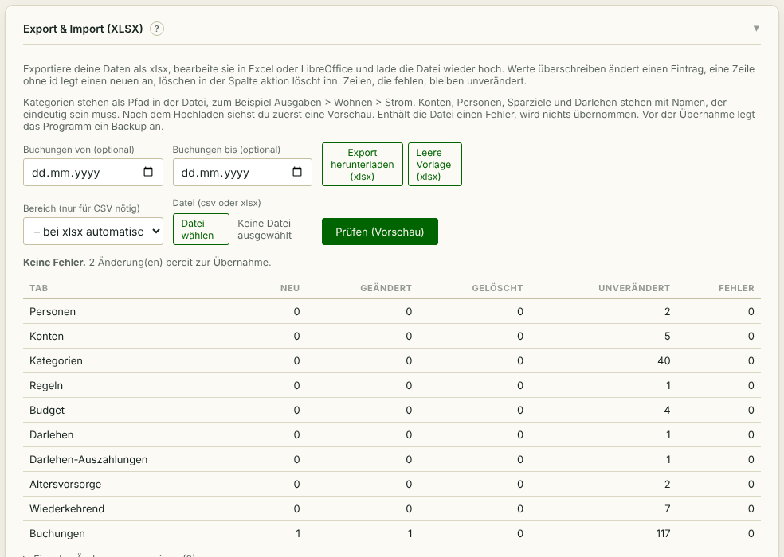

**Siehe auch:** [Backups und Datenbank](#admin.backups)

### Automatische Kategorisierung
<!-- kapitel: admin.regeln -->
<!-- stichworte: Regel, Muster, Priorität, Kategorisierung -->

**Wofür?** Das Programm erkennt die Kategorie an der Beschreibung, zum Beispiel REWE als Lebensmittel/Verpflegung.

**So geht's**

1. Öffne „Administration“, Reiter „Stammdaten“, Block „Automatische Kategorisierung“.
2. Trag bei „Muster (Textbestandteil)“ ein Stück Text ein, zum Beispiel REWE.
3. Wähle die „Kategorie“.
4. Trag eine „Priorität“ ein. Eine kleinere Zahl wird zuerst geprüft.
5. Klicke auf „Regel anlegen“.

**Gut zu wissen**

<!-- hinweis: admin.regeln -->
Enthält die Beschreibung einer Buchung das Muster, setzt das Programm die Kategorie, sofern keine gewählt wurde. Groß- und Kleinschreibung spielen keine Rolle.
<!-- /hinweis -->

- Das hilft vor allem bei Siri, wenn du keine Kategorie mitschickst.

**Siehe auch:** [Siri: Kurzbefehl anlegen](#schnellbuchung.siri-kurzbefehl)

### Vorzeichen prüfen
<!-- kapitel: admin.vorzeichen -->
<!-- stichworte: Vorzeichen, Vorzeichen korrigieren -->

**Wofür?** Du findest Buchungen und Vorlagen, bei denen Einnahme und Ausgabe vertauscht sind.

**So geht's**

1. Öffne „Administration“, Reiter „Stammdaten“, Block „Vorzeichen prüfen“.
2. Klicke auf „Jetzt prüfen“.
3. Stimmt die Liste, klicke auf „Alle korrigieren“.

**Gut zu wissen**

<!-- hinweis: admin.vorzeichen -->
Ausgaben müssen negativ, Einnahmen positiv gebucht sein. Passt ein Vorzeichen nicht zur Kategorie, stimmen Saldo, Cashflow und Budgets nicht.
<!-- /hinweis -->

- Das Programm prüft das auch bei jedem Öffnen und zeigt dann einen Hinweis auf der Startseite.

**Siehe auch:** [Hinweise auf der Startseite](#start.hinweise)

### Sparziele prüfen
<!-- kapitel: admin.sparziele -->
<!-- stichworte: Sparziel prüfen, Zuordnung lösen -->

**Wofür?** Du findest Buchungen und Vorlagen, die ein Sparziel tragen, aber nicht dazu passen.

**So geht's**

1. Öffne „Administration“, Reiter „Stammdaten“, Block „Sparziele prüfen“.
2. Klicke auf „Jetzt prüfen“.
3. Lass die Einträge angehakt, deren Sparziel entfernt werden soll.
4. Klicke auf „Markierte Zuordnungen lösen“.

**Gut zu wissen**

<!-- hinweis: admin.sparziele -->
Ein Sparziel gehört nur an eine Übertragung von oder zu seinem Trägerkonto. Andere Zuordnungen zählen nicht zum Stand und stehen hier. „Markierte Zuordnungen lösen“ entfernt nur das Sparziel, die Buchung bleibt.
<!-- /hinweis -->

- Das Programm prüft das auch bei jedem Öffnen und zeigt dann einen Hinweis auf der Startseite.

**Siehe auch:** [Sparziel anlegen](#budgets.sparziel)

### Feiertage
<!-- kapitel: admin.feiertage -->
<!-- stichworte: Feiertage, Bundesland, Bankfeiertag, Werktag, Sonderfall -->

**Wofür?** Das Programm weist dich auf Feiertage in deinem Bundesland hin. Dafür wählst du dein Bundesland.

**So geht's**

1. Beim ersten Start fragt das Programm nach deinem Bundesland. Wähle es und klicke auf „Übernehmen“.
2. Willst du es später ändern, öffne „Administration“, Reiter „Stammdaten“, Block „Feiertage“.
3. Wähle das „Bundesland“ und klicke auf „Speichern“. Darunter siehst du die Feiertage des laufenden Jahres.

**Gut zu wissen**

<!-- hinweis: admin.feiertage -->
Die Auswahl bestimmt nur, welche Tage als Feiertag markiert werden. Buchungen, Termine und Prognose ändern sich nicht.
<!-- /hinweis -->

<!-- hinweis: feiertage.erststart -->
Wähle dein Bundesland. Das Programm markiert damit Feiertage, wenn du ein Datum eingibst, und in der Buchungsliste. Ändern kannst du die Auswahl später unter „Administration“, Block „Feiertage“.
<!-- /hinweis -->

<!-- hinweis: feiertage.serie -->
Diese Termine der nächsten 12 Monate fallen auf einen Feiertag. Das ist nur ein Hinweis, gebucht wird trotzdem:
<!-- /hinweis -->

<!-- hinweis: feiertage.import -->
Diese Daten aus der Datei fallen auf einen Feiertag. Das ist nur ein Hinweis, übernommen wird trotzdem:
<!-- /hinweis -->

- Gilt bei dir ein Feiertag nur in manchen Orten, wähle den passenden Eintrag, zum Beispiel „Bayern – mit Mariä Himmelfahrt“ oder „Sachsen – mit Fronleichnam“. Welche Feiertage in deinem Ort gelten, erfährst du bei deiner Gemeinde.
- Feiertage sperren nichts. Du kannst an jedem Tag buchen.
- Verschoben werden Termine nur an Wochenenden und Bankfeiertagen. Das sind die Tage, an denen der Zahlungsverkehr der Banken ruht.
- Das Programm berechnet die Feiertage selbst. Eine Internetverbindung ist nicht nötig.
- Gedenktage und Schulferien markiert das Programm nicht.

**Siehe auch:** [Wann wird gebucht?](#wiederkehrend.automatik), [Buchungsliste filtern](#buchungen.liste)

### Serverzeit
<!-- kapitel: admin.serverzeit -->
<!-- stichworte: Serverzeit, Zeitzone, heute -->

**Wofür?** Du siehst, welches Datum und welche Uhrzeit das Programm für „heute“ verwendet.

**So geht's**

1. Öffne „Administration“, Reiter „System“, Block „Serverzeit“.
2. Lies die erste Angabe. Sie ist maßgeblich.

**Gut zu wissen**

<!-- hinweis: admin.serverzeit -->
Das Programm rechnet immer mit deutscher Zeit. Maßgeblich für „heute“ ist die erste Angabe.
<!-- /hinweis -->

**Siehe auch:** [Wann wird gebucht?](#wiederkehrend.automatik)

### Menü-Reihenfolge
<!-- kapitel: admin.menue -->
<!-- stichworte: Menü, Reihenfolge, Trennlinie -->

**Wofür?** Du ordnest die Seitenleiste so, wie du arbeitest.

**So geht's**

1. Öffne „Administration“, Reiter „System“, Block „Menü-Reihenfolge“.
2. Verschiebe einen Eintrag mit „↑“ und „↓“.
3. Hake „Trenner davor“ an, wenn vor einem Eintrag eine Trennlinie stehen soll.
4. Klicke auf „Speichern“.

**Gut zu wissen**

<!-- hinweis: admin.menue -->
Lege Reihenfolge und Trennlinien der Menüpunkte fest. „Start“ steht immer oben, „Hilfe“ und „Administration“ stehen immer unten.
<!-- /hinweis -->

**Siehe auch:** [So findest du dich zurecht](#erste-schritte.bedienung)

### Backups und Datenbank
<!-- kapitel: admin.backups -->
<!-- stichworte: Backup, Datensicherung, Datenbank herunterladen -->

**Wofür?** Du sicherst deine Daten und kannst sie auf deinem Rechner aufbewahren.

**So geht's**

1. Öffne „Administration“, Reiter „System“, Block „Backups“.
2. Klicke auf „Backup jetzt erstellen“ für eine Sicherung im Programm.
3. Klicke auf „Datenbank herunterladen“, um eine Kopie aller Daten auf deinem Rechner zu speichern.

**Gut zu wissen**

- Das Programm sichert automatisch am 15. und am Monatsende. Es behält die letzten zwölf Sicherungen, ältere löscht es.
- Vor jedem Import, vor jedem Zurücksetzen und vor jedem Wiederherstellen legt das Programm ebenfalls ein Backup an. Die Spalte „Beschreibung“ nennt den Anlass.
- Mit „Wiederherstellen“ in einer Zeile spielst du dieses Backup zurück.
- Lade die Datenbank immer herunter, bevor du das Add-on deinstallierst. Eine Deinstallation löscht alle Daten.

**Siehe auch:** [Datenbank wiederherstellen](#admin.wiederherstellen), [Export und Import](#admin.export-import)

### Datenbank wiederherstellen
<!-- kapitel: admin.wiederherstellen -->
<!-- stichworte: Wiederherstellen, Datenbank hochladen, Umzug, Rücksicherung -->

**Wofür?** Du spielst eine gesicherte Datenbank zurück, zum Beispiel nach einem Fehler oder beim Umzug in ein neu installiertes Add-on.

**So geht's**

1. Öffne „Administration“, Reiter „System“.
2. Für eine Datei von deinem Rechner: Klicke im Block „Datenbank wiederherstellen“ auf „Datei wählen“, wähle die Datei und klicke auf „Prüfen“.
3. Für ein Backup aus dem Programm: Klicke im Block „Backups“ in der passenden Zeile auf „Wiederherstellen“.
4. Ein Fenster zeigt den jetzigen Stand und den Stand der Datei nebeneinander. Vergleiche Konten, Buchungen und die letzte Ist-Buchung.
5. Tippe die angezeigte Phrase ab und klicke auf „Jetzt wiederherstellen“.
6. Klicke auf „Seite neu laden“.

**Gut zu wissen**

<!-- hinweis: admin.wiederherstellen -->
Ersetzt alle Daten durch die einer gesicherten Datenbank. Vorher prüft das Programm die Datei und legt ein Backup des jetzigen Stands an.
<!-- /hinweis -->

<!-- hinweis: admin.wiederherstellen-bestaetigen -->
Alle jetzigen Daten werden ersetzt. Der jetzige Stand bleibt als Backup „vor Wiederherstellung“ in der Backup-Liste.
<!-- /hinweis -->

- Passt eine Datei nicht, etwa weil sie keine Datenbank dieses Programms ist, lehnt das Programm sie ab und ändert nichts.
- Stammt die Datei aus einer älteren Programmversion, passt das Programm sie wie bei einem Update an. Was es geändert hat, steht danach im Fenster.
- Die Backup-Liste bleibt die dieses Programms. Sicherungen aus der eingespielten Datei tauchen darin nicht auf.
- Die Phrase gilt zehn Minuten und nur einmal.

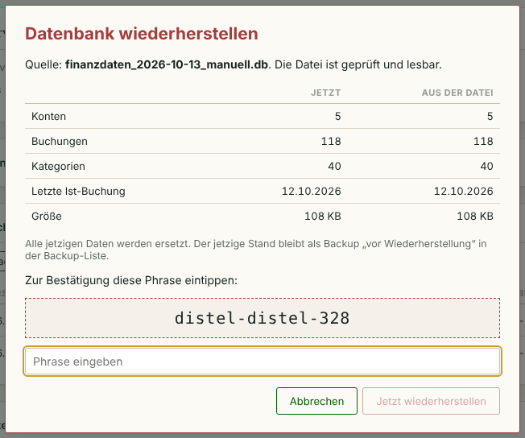

**Siehe auch:** [Backups](#admin.backups), [Daten in ein neues Add-on umziehen](#rezepte.umzug)

### Farben
<!-- kapitel: admin.farben -->
<!-- stichworte: Farben, Aussehen -->

**Wofür?** Du passt die Farben der Oberfläche an deinen Geschmack an.

**So geht's**

1. Öffne „Administration“, Reiter „System“, Block „Farben“.
2. Wähle die Farben für „Grundton (Sidebar/Buttons)“, „Akzent (Messing)“, „Positiv (Grün)“, „Negativ (Rot)“ und „Hintergrund (Papier)“.
3. Klicke auf „Speichern“. Mit „Auf Standard zurücksetzen“ kommen die ursprünglichen Farben zurück.

**Gut zu wissen**

<!-- hinweis: admin.farben -->
Ändert die Grundfarben der Oberfläche. Die neuen Farben gelten nach dem Speichern sofort in diesem Browser und für alle, die die Seite neu laden.
<!-- /hinweis -->

**Siehe auch:** [Konto anlegen oder ändern](#konten.anlegen)

## Daten zurücksetzen
<!-- kapitel: zuruecksetzen -->

Hier löschst du größere Mengen Daten auf einmal. Das ist praktisch nach einem Test oder vor einem Neuanfang.

### So läuft das Zurücksetzen ab
<!-- kapitel: zuruecksetzen.ablauf -->
<!-- stichworte: Zurücksetzen, Bestätigungsphrase, Daten löschen -->

**Wofür?** Du entfernst gezielt bestimmte Daten, ohne alles neu einrichten zu müssen.

**So geht's**

1. Öffne „Administration“, Reiter „Daten zurücksetzen“.
2. Hake an, was gelöscht werden soll. Bei Konten wählst du zusätzlich die Konten aus.
3. Klicke auf „Ausgewählte Daten löschen …“.
4. Prüfe die Übersicht mit der Anzahl der betroffenen Daten und klicke auf „Weiter“.
5. Tippe die angezeigte Phrase ab und klicke auf „Endgültig löschen“.

**Gut zu wissen**

<!-- hinweis: zuruecksetzen.warnung -->
Löscht die ausgewählten Daten dauerhaft. Vorher legt das Programm automatisch ein Backup an. Du bestätigst zweimal und tippst zum Schluss eine zufällige Phrase ab.
<!-- /hinweis -->

<!-- hinweis: zuruecksetzen.fragezeichen -->
Das Fragezeichen neben jeder Auswahl zeigt kurz, was gelöscht wird. Von dort kommst du zum passenden Kapitel der Hilfe.
<!-- /hinweis -->

- Personen, Kategorien, Budgets und Einstellungen bleiben immer erhalten.
- Die Phrase gilt zehn Minuten und nur für genau diese Auswahl.
- Gelöscht wird ganz oder gar nicht. Schlägt das Backup fehl, wird nichts gelöscht.

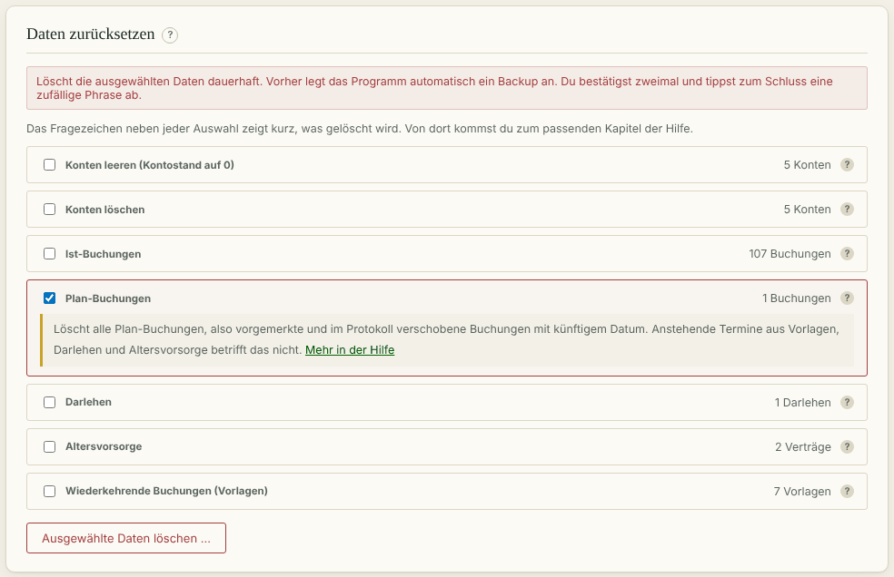

**Siehe auch:** [Backups und Datenbank](#admin.backups)

### Konten leeren
<!-- kapitel: zuruecksetzen.konten-leeren -->
<!-- stichworte: Konten leeren, Kontostand null -->

**Wofür?** Ein Konto soll wieder bei 0 € anfangen, bleibt aber bestehen.

**So geht's**

1. Hake „Konten leeren (Kontostand auf 0)“ an.
2. Wähle die Konten aus.
3. Weiter wie unter „So läuft das Zurücksetzen ab“.

**Gut zu wissen**

<!-- hinweis: zuruecksetzen.konten-leeren -->
Löscht alle Buchungen und Saldo-Korrekturen der gewählten Konten. Die Konten bleiben und stehen danach auf 0 €. Übertragungen zu anderen Konten werden mitgelöscht und ändern dort den Stand.
<!-- /hinweis -->

- Hängen am Konto noch Vorlagen, Darlehen oder Altersvorsorge, buchen diese künftige Termine weiter.

**Siehe auch:** [Konten löschen](#zuruecksetzen.konten-loeschen)

### Konten löschen
<!-- kapitel: zuruecksetzen.konten-loeschen -->
<!-- stichworte: Konto löschen, Zielkonto, Konto auflösen -->

**Wofür?** Du löst ein Konto auf, zum Beispiel nach einem Bankwechsel.

**So geht's**

1. Hake „Konten löschen“ an und wähle die Konten aus.
2. Löschst du nicht alle Konten, fragt das Programm nach einem Zielkonto.
3. Weiter wie unter „So läuft das Zurücksetzen ab“.

**Gut zu wissen**

<!-- hinweis: zuruecksetzen.konten-loeschen -->
Entfernt die gewählten Konten. Bei einer Teilauswahl wählst du ein Zielkonto, auf das Buchungen, Vorlagen und Verträge umgestellt werden. Saldo-Korrekturen der gelöschten Konten gehen verloren.
<!-- /hinweis -->

- Übertragungen, die danach von einem Konto auf dasselbe laufen würden, entfallen.
- Umbuchungs-Vorlagen mit gleichem Konto und Zielkonto werden deaktiviert, nicht gelöscht.
- Weil Saldo-Korrekturen wegfallen, kann sich die Summe deiner Kontostände ändern. Der Bestätigungsdialog nennt den Betrag.
- Löschst du alle Konten, musst du auch „Wiederkehrende Buchungen (Vorlagen)“ und „Altersvorsorge“ anhaken.

**Siehe auch:** [Konten leeren](#zuruecksetzen.konten-leeren)

### Ist-Buchungen löschen
<!-- kapitel: zuruecksetzen.ist-buchungen -->
<!-- stichworte: Ist-Buchungen löschen -->

**Wofür?** Du entfernst alte Buchungen bis zu einem Stichtag, zum Beispiel nach einem Probelauf.

**So geht's**

1. Hake „Ist-Buchungen“ an.
2. Wähle bei „Ist-Buchungen und Übertragungen löschen bis einschließlich“ den Stichtag.
3. Weiter wie unter „So läuft das Zurücksetzen ab“.

**Gut zu wissen**

<!-- hinweis: zuruecksetzen.ist-buchungen -->
Löscht alle Ist-Buchungen und Übertragungen bis einschließlich des gewählten Datums, auch automatisch gebuchte. Spätere Buchungen und Plan-Buchungen bleiben.
<!-- /hinweis -->

- Gelöschte automatische Buchungen entstehen nicht neu. Künftige Termine werden weiter gebucht.

**Siehe auch:** [Plan-Buchungen löschen](#zuruecksetzen.plan-buchungen)

### Plan-Buchungen löschen
<!-- kapitel: zuruecksetzen.plan-buchungen -->
<!-- stichworte: Plan-Buchungen löschen -->

**Wofür?** Du entfernst alle vorgemerkten Zahlungen auf einmal.

**So geht's**

1. Hake „Plan-Buchungen“ an.
2. Weiter wie unter „So läuft das Zurücksetzen ab“.

**Gut zu wissen**

<!-- hinweis: zuruecksetzen.plan-buchungen -->
Löscht alle Plan-Buchungen, also vorgemerkte und im Protokoll verschobene Buchungen mit künftigem Datum. Anstehende Termine aus Vorlagen, Darlehen und Altersvorsorge betrifft das nicht.
<!-- /hinweis -->

**Siehe auch:** [Protokoll prüfen](#plan.protokoll)

### Darlehen, Altersvorsorge und Vorlagen löschen
<!-- kapitel: zuruecksetzen.vertraege -->
<!-- stichworte: Darlehen löschen, Altersvorsorge löschen, Vorlagen löschen -->

**Wofür?** Du entfernst Verträge oder Vorlagen, die es nicht mehr gibt.

**So geht's**

1. Hake „Darlehen“, „Altersvorsorge“ oder „Wiederkehrende Buchungen (Vorlagen)“ an.
2. Weiter wie unter „So läuft das Zurücksetzen ab“.

**Gut zu wissen**

<!-- hinweis: zuruecksetzen.darlehen -->
Löscht alle Darlehen mit ihren Auszahlungen. Schon gebuchte Zahlungen bleiben als normale Buchungen erhalten.
<!-- /hinweis -->

<!-- hinweis: zuruecksetzen.altersvorsorge -->
Löscht alle Altersvorsorge-Verträge. Schon gebuchte Beiträge und Renten bleiben als normale Buchungen erhalten.
<!-- /hinweis -->

<!-- hinweis: zuruecksetzen.wiederkehrend -->
Löscht alle Vorlagen. Schon gebuchte Zahlungen bleiben erhalten. Danach entstehen keine automatischen Buchungen aus Vorlagen mehr.
<!-- /hinweis -->

- Einzelne Vorlagen und Verträge löschst du direkt in ihrem Bereich mit „Löschen“.

**Siehe auch:** [Vorlagen ändern, pausieren, löschen](#wiederkehrend.verwalten), [Verträge verwalten](#altersvorsorge.liste)

## Wie mache ich …?
<!-- kapitel: rezepte -->

Kurze Anleitungen für häufige Aufgaben. Der Verweis am Ende führt zum ausführlichen Kapitel.

### … meinen Kontostand an den Kontoauszug anpassen?
<!-- kapitel: rezepte.kontostand -->

Öffne „Konten“, trag im Block „Saldo-Korrektur“ Konto, Datum und Stand laut Auszug ein und klicke auf „Korrektur anlegen“. Ausführlich: [Kontostand festlegen](#konten.saldo-korrektur)

### … eine monatliche Sparrate einrichten?
<!-- kapitel: rezepte.sparrate -->

Öffne „Wiederkehrend“, wähle bei „Art“ „Umbuchung“, wähle Girokonto und Zielkonto, Betrag und Tag und klicke auf „Anlegen“. Ausführlich: [Umbuchung als Vorlage](#wiederkehrend.umbuchung)

### … auf einen Urlaub sparen?
<!-- kapitel: rezepte.urlaub -->

Lege unter „Budgets“ ein Sparziel mit Trägerkonto und Zielbetrag an. Ordne dann deine Sparrate diesem Sparziel zu. Ausführlich: [Sparziel anlegen](#budgets.sparziel)

### … eine Rechnung vormerken, die später fällig ist?
<!-- kapitel: rezepte.vormerken -->

Erfasse unter „Buchungen“ eine Buchung mit „Typ“ „Plan“ und dem Fälligkeitsdatum. An dem Tag wird sie von selbst zur Ist-Buchung. Ausführlich: [Buchung erfassen](#buchungen.erfassen)

### … eine automatische Buchung korrigieren, die anders kam?
<!-- kapitel: rezepte.korrigieren -->

Öffne „Plan-Buchungen“ und klicke bei der Buchung auf „Datum ändern“. Kam sie gar nicht, nimm „Verwerfen“, aber beachte, dass das bei Vorlagen auch die Vorlage anhält. Ausführlich: [Protokoll prüfen](#plan.protokoll)

### … sehen, wie viel ich für Lebensmittel ausgebe?
<!-- kapitel: rezepte.lebensmittel -->

Wähle in der „Jahresübersicht“ unter „Kategorien“ nur „Lebensmittel/Verpflegung“. Oder lege ein Budget für Lebensmittel an. Ausführlich: [Jahresübersicht lesen](#jahr.lesen)

### … unterwegs schnell eine Ausgabe buchen?
<!-- kapitel: rezepte.unterwegs -->

Nutze die Schnellbuchung auf dem Handy oder den Siri-Kurzbefehl. Ausführlich: [Schnellbuchung nutzen](#schnellbuchung.nutzen)

### … viele Daten auf einmal ändern?
<!-- kapitel: rezepte.excel -->

Exportiere unter Administration die Daten als xlsx, ändere sie in Excel und lade die Datei wieder hoch. Ausführlich: [Export und Import](#admin.export-import)

### … meine Daten sichern?
<!-- kapitel: rezepte.sichern -->

Klicke unter Administration, Reiter „System“, Block „Backups“ auf „Datenbank herunterladen“. Ausführlich: [Backups und Datenbank](#admin.backups)

### … meine Daten in ein neu installiertes Add-on umziehen?
<!-- kapitel: rezepte.umzug -->

Lade im alten Add-on unter „Administration“, Reiter „System“, die Datenbank herunter. Installiere das neue Add-on und spiele die Datei dort unter „Datenbank wiederherstellen“ ein. Prüfe Konten und Salden. Erst dann entfernst du das alte Add-on. Ausführlich: [Datenbank wiederherstellen](#admin.wiederherstellen)

### … ein Konto auflösen?
<!-- kapitel: rezepte.konto-aufloesen -->

Lösche das Konto unter Administration bei „Daten zurücksetzen“ mit „Konten löschen“ und wähle ein Zielkonto für seine Buchungen. Ausführlich: [Konten löschen](#zuruecksetzen.konten-loeschen)

### … das Handbuch ausdrucken?
<!-- kapitel: rezepte.handbuch -->

Öffne die „Hilfe“ und klicke oben auf „PDF-Handbuch“. Das PDF hat ein Inhaltsverzeichnis, Seitenzahlen und Lesezeichen. Ausführlich: [So findest du dich zurecht](#erste-schritte.bedienung)

## Begriffe von A bis Z
<!-- kapitel: begriffe -->

**Altersvorsorge:** Ein Vertrag, in den du einzahlst und aus dem du später eine Rente oder eine Einmalzahlung bekommst.

**Anstehender Termin:** Eine Zahlung aus einer Vorlage, einem Darlehen oder einer Altersvorsorge, die noch kommt. Sie ist noch nicht gespeichert.

**Bankfeiertag:** Ein Feiertag, an dem der Zahlungsverkehr der Banken ruht: Neujahr, Karfreitag, Ostermontag, 1. Mai, 25. und 26. Dezember. Termine an diesen Tagen bucht das Programm am Werktag davor.

**Budget:** Ein Betrag, den du für eine Kategorie je Periode einplanst.

**Cashflow:** Was in einem Zeitraum hereinkommt und hinausgeht.

**Darlehen:** Ein Kredit mit Auszahlungen, Zinsen und Tilgung.

**Einmalzahlung:** Eine Altersvorsorge, die zum Rentenbeginn einen Betrag auf einmal auszahlt.

**Gesamtsaldo:** Die Summe aller Konten, bei denen „Im Gesamtsaldo“ angehakt ist.

**Inflationsfaktor:** Die angenommene jährliche Teuerung in Prozent.

**Ist-Buchung:** Eine Zahlung, die schon passiert ist.

**Kategorie:** Die Einordnung einer Buchung, zum Beispiel „Lebensmittel/Verpflegung“. Sie bestimmt, ob ein Betrag Einnahme oder Ausgabe ist.

**Korridor:** Die Spanne zwischen garantierten und voraussichtlichen Renten in den Auswertungen.

**Nettovermögen:** Die Summe deiner Konten minus der Restschuld deiner Darlehen.

**Periode:** Der Zeitraum eines Budgets, zum Beispiel ein Monat.

**Plan-Buchung:** Eine vorgemerkte Zahlung in der Zukunft. An ihrem Datum wird sie zur Ist-Buchung.

**Prognose:** Die Rechnung des Programms für die Zukunft aus Vorlagen, Darlehen und Altersvorsorge.

**Restschuld:** Was von einem Darlehen noch zurückzuzahlen ist.

**Saldo:** Der Stand eines Kontos.

**Saldo-Korrektur:** Ein festgelegter Kontostand an einem Tag.

**Sparquote:** Der Anteil der Einnahmen, der nach allen Ausgaben übrig bleibt.

**Sondertilgung:** Eine Rückzahlung außer der Reihe.

**Sparziel:** Ein Budget, auf das du hinsparst. Es liegt auf einem Trägerkonto.

**Trägerkonto:** Das Konto, auf dem das Geld eines Sparziels liegt.

**Übertragung:** Geld, das von einem deiner Konten auf ein anderes geht.

**Umbuchung:** Eine Vorlage für regelmäßige Übertragungen.

**Vorlage:** Eine Zahlung, die regelmäßig wiederkommt und automatisch gebucht wird.

**Werktag:** Ein Tag, der kein Samstag, Sonntag oder Bankfeiertag ist.

**Zinsbindung:** Der Zeitraum, für den der Zinssatz eines Darlehens fest vereinbart ist.

## Stichwortverzeichnis
<!-- kapitel: stichwortverzeichnis -->
<!-- automatisch: stichwortverzeichnis -->
